# 更好的自己智能成长管理平台项目计划书

## 中国国际大学生创新大赛 2026 参赛材料

| 项目 | 内容 |
| --- | --- |
| 项目名称 | 更好的自己智能成长管理平台 |
| 项目定位 | 面向大学生自主学习与日常成长的目标管理、任务执行和反馈复盘工具 |
| 项目负责人 | 杨旭光 |
| 团队成员 | 杨旭光、丁恩鹏、张十全、陈益新、路博勋 |
| 核心研发周期 | 2026 年 7 月 15 日至 2026 年 9 月 15 日 |
| 当前阶段 | 已形成可运行系统，进入试点验证和参赛材料完善阶段 |
| 申报口径 | 按高教主赛道创意组的评审逻辑编制，实际赛道及组别须经学校审核 |
| 所属学校及学院 | 【待填写学校全称、学院全称】 |
| 团队专业及年级 | 【待核实五名成员的专业、年级和学籍情况】 |
| 指导教师 | 【待填写姓名、职称、单位及实际指导内容】 |
| 联系方式 | 【待填写负责人电话及邮箱】 |
| 材料核验日期 | 2026 年 9 月 16 日 |
| 文档版本 | V1.0 Markdown 编辑版 |

### 编制与真实性说明

1. 本计划书依据当前项目源代码、数据库迁移、部署配置、项目内技术文档以及已实际取得的验证结果编写。业务能力、市场假设和后续计划分别表述，不以开发截图代替市场验证，不以测试账号代替真实用户。
2. 团队提供的研发周期为 **7 月 15 日至 9 月 15 日**；本稿按当前年份编排为 **2026 年**，提交前须由团队确认年份。本材料以 9 月 16 日可核验的系统状态说明技术细节；其中当天补充的系统知识库、上下文增强和目标草案契约校验，单独列为研发期后完善，不倒填为 9 月 15 日前成果。
3. 团队人员以本次确认的五人为准。本文不沿用仓库旧文档中的六人分工或四周周期。分工按现有模块复杂度整理，提交前应由五人共同确认，并与提交记录、设计文档、测试记录和演示职责对应。
4. 学校、专业、指导教师、企业注册情况、知识产权登记、用户调研、合作机构和实际收入等尚未提供证据的事项，均不作已完成声明。文中的测算与试点目标不构成实际经营业绩或效果保证。
5. 2026 年高教主赛道创意组评审关注个人成长、项目创新、产业价值及团队协作，分值分别为 30、30、25、15；材料真实性和成员实质贡献是提交前必须核对的内容。本文按这些维度安排章节，不将自拟章节结构称为官方固定模板。[R1][R2]
6. 本文件为可编辑 Markdown。所有代码围栏为 `mermaid` 的内容均为可渲染图表源代码；“系统截图”备注需替换为本系统真实截图。根据提供的上传界面，最终上传格式限 PDF 或 Word、单文件且不超过 20 MB，因此本文件完成补图后仍需渲染并转换，不能直接作为该界面的上传文件。

## 目录

1. 项目摘要
2. 需求分析与市场定位
3. 产品方案与业务流程
4. 技术架构与核心实现
5. 项目创新与竞争分析
6. 当前成果与验证方案
7. 商业模式与运营计划
8. 团队组织与成员分工
9. 研发进度与后续路线
10. 经费预算与经营测算
11. 数据安全与合规边界
12. 风险分析与应对
13. 育人成效与社会价值
14. 参赛演示与提交检查
15. 附录 A 各功能数据流转图
16. 附录 B 系统截图清单
17. 附录 C 证据索引与参考资料

---

## 一 项目摘要

### 1.1 项目概述

“更好的自己”是一套已经具备前后端运行能力的个人成长管理系统。项目面向大学生日常学习、阶段性技能积累和自我管理场景，将目标拆解、周期任务、每日状态、任务反馈、成长可视化、AI 辅助和可选社交整合在同一条业务链路中。

项目拟解决的核心问题不是“用户没有记录工具”，而是“目标难以转化为符合当日状态的行动，行动结果又难以反馈到下一轮计划”。系统通过有限数量的阶段目标、具体起步任务、可撤销执行事件和每周复盘，帮助用户观察自己实际能够持续执行的节奏。

当前成果属于**可运行的应用型创新原型**。系统已形成注册登录、目标与任务管理、今日执行、成长反馈、AI 助手、伙伴互动、好友与群聊、数据隐私和管理端等模块。AI 使用已有外部模型服务，团队的工作重点是业务流程、上下文组织、结构化输出、安全约束和用户确认机制，并非从零训练基础大模型。

### 1.2 主要价值

| 使用环节 | 用户问题 | 本项目的处理方式 | 验证方式 |
| --- | --- | --- | --- |
| 规划 | 目标过大，缺少清晰起点 | 将阶段目标转为有限起步任务，支持编辑与手动创建 | 首个目标创建与任务配置可用性测试 |
| 执行 | 时间和精力变化后原计划难以坚持 | 记录当日状态，允许部分完成、延期和跳过 | 状态检查与任务操作链路测试 |
| 反馈 | 仅有打卡数，难以理解实际进展 | 根据任务事件呈现属性、角色成长、洞察与复盘 | 指标计算与事件回溯检查 |
| AI 辅助 | 通用回答与系统表单脱节 | 对话围绕目标字段组织，草案经校验后由用户确认 | 草案字段校验、错误恢复和人工评价 |
| 持续使用 | 工具反馈单一，社交压力较大 | 可选成长伙伴、成就称号和好友交流，支持独自升级 | 自愿试点访谈及退出体验测试 |

### 1.3 当前证据与下一步目标

已具备的证据包括可运行代码、16 个版本化数据库迁移文件、测试代码、配置文件及本地运行检查。2026 年 9 月 16 日的非 Docker 后端回归中，67 项测试通过；本地服务启动后，后端健康检查为 `UP`，前端访问及代理链路正常。这些结果证明特定环境中的开发可用性，**不等于生产环境安全认证、商业化成功或全部测试均通过**。[E01][E12]

下一阶段先进行小范围自愿试用，重点验证首个目标创建是否容易、AI 草案能否正确落入表单、每日任务安排是否可执行、用户是否愿意持续复盘。只有在需求、留存、安全和成本数据得到支持后，才推进付费服务或机构合作。

**【系统截图 S01 待插入】** 系统首页或“今日”页面全景。保留导航、今日状态和任务区域，使用演示账号；不得展示真实邮箱、聊天内容或访问凭据。建议宽度不低于 1600 像素，图注为“图 S01 更好的自己系统首页”。

---

## 二 需求分析与市场定位

### 2.1 问题背景

大学生需要在课程学习、技能训练、求职准备与日常生活之间安排有限时间。对本项目而言，值得验证的需求不是抽象的“提高自律”，而是三个可观察的问题：用户能否把目标拆成小任务，能否在状态变化后调整任务，能否根据实际执行结果修正下一周计划。

教育部《2025 年全国教育事业发展统计公报》公布的高等教育毛入学率为 61.30%，说明高等教育具有广泛的服务场景基础。[R3] 但教育统计不能直接推导本项目的付费市场，更不能把所有大学生视为客户。本项目优先从团队可直接接触、愿意持续反馈的校园用户中验证需求。

### 2.2 目标用户

| 用户类别 | 典型事项 | 当前优先级 | 服务边界 |
| --- | --- | --- | --- |
| 有阶段性学习目标的大学生 | 课程复习、阅读、练习、技能积累 | 首期核心用户 | 不承诺考试成绩，不代替教师评价 |
| 求职或实习准备中的学生 | 作品整理、资料学习、沟通准备 | 首期辅助场景 | 不保证录用、收入或职业结果 |
| 希望建立温和生活节奏的成年人 | 运动记录、睡眠记录、日常整理 | 在安全审查后试点 | 不提供诊断、处方或治疗方案 |
| 自愿参加成长活动的校园组织 | 学习互助、经验交流、活动实践 | 后续合作对象 | 不默认获取成员私人目标和 AI 对话 |

现有系统保留学习、身体照顾、职场和情绪支持四类场景。对外推广时先集中于大学生学习与日常成长，不因功能覆盖范围较广而同时宣称进入医疗、心理咨询、企业人力资源等专业服务市场。

### 2.3 待验证的需求假设

1. 相比只记录目标，用户更需要能直接开始的短任务。
2. 用户的计划失败可能与任务过量或状态不匹配有关，而不只是缺少提醒。
3. AI 建议只有在可编辑、可核对并能进入目标表单时，才更容易形成实际行动。
4. 伙伴与成就可能提升反馈感，但其价值应由试用结果验证，不能等同于稳定留存。
5. 社交功能应允许用户退出或独立使用，避免把公开排行和连续打卡压力设为必要条件。

上述内容是产品假设，不是已经完成的问卷结论。本计划书不填入未经提供的调研比例、满意度或效果提升幅度。

### 2.4 调研与试点设计

拟开展三个阶段的验证，参与者需知情、自愿，调查内容与使用目标相关，不收集不必要的敏感信息。

| 阶段 | 建议样本与周期 | 主要问题 | 应保留的证据 |
| --- | --- | --- | --- |
| 需求探索 | 15 名学生访谈，2 周 | 当前如何安排目标，在哪个环节放弃，是否愿意接受 AI 建议 | 访谈提纲、匿名摘要、明确授权 |
| 结构化调查 | 约 120 份有效问卷，2 周 | 任务拆解、时间安排、隐私顾虑和使用意愿 | 原始匿名数据、清洗规则、问卷版本 |
| 产品试用 | 40 名自愿用户，4 周 | 首次使用阻力、任务执行、AI 草案采纳及复盘情况 | 事件口径、问题记录、退出原因、试用报告 |

样本规模是组织计划，不代表统计学意义上的全国性结论。问卷结果应报告招募方式、有效样本数和局限；功能测试账号、团队成员账号与外部试用账号分开统计。

### 2.5 市场切入路径

采用“单校小范围验证—同类学习场景复用—审慎扩展合作”的路径。可触达人数、实际激活人数、留存人数和付费意愿分别计算，不以大行业规模代替可服务市场。首期不以买量或夸大 AI 能力获取用户，也不把潜在交流对象列为签约合作方。

---

## 三 产品方案与业务流程

### 3.1 产品定位与设计原则

系统定位为个人成长的规划和反馈工具，而不是能力评级系统、医疗服务或强制考核平台。产品遵循以下原则：

- **少量明确目标。** 目标周期限定为 14—84 天，最多同时存在 3 个进行中目标，避免无限制增加承诺。
- **行动可调整。** 支持完成、部分完成、延期、跳过等操作，并通过受控撤销纠正误操作。
- **反馈有依据。** 经验、成长属性和洞察来源于记录，不等于真实能力或人格评分。
- **AI 不替用户作决定。** 对话和草案本身不直接创建任务，落地前需用户编辑、确认。
- **参与可选择。** 伙伴、社交和外观属于辅助体验，不影响手动规划的基础可用性。

### 3.2 功能结构图

图 M01 展示现有功能分组。分组用于说明产品结构，不代表后端采用独立微服务。

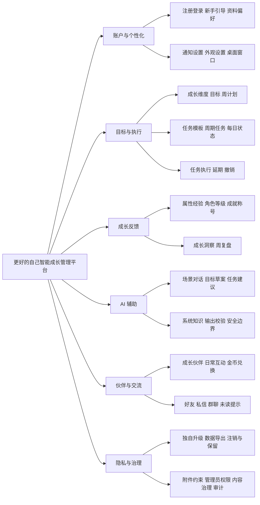

### 3.3 用户核心流程图

图 M02 为主要使用闭环。AI 失败时仍能使用手动规划，社交和伙伴不是完成成长任务的前置条件。

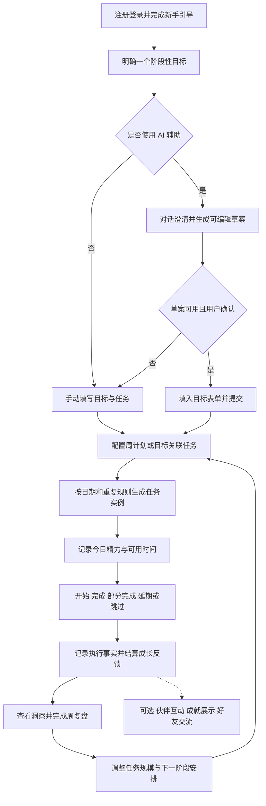

### 3.4 功能状态与交付范围

本文使用四类状态：A 为当前代码中存在的功能；B 为接口或基础机制存在但仍需生产适配；C 为 9 月 16 日新增完善；P 为后续规划。A 不代表该功能已经在真实用户规模下完成运营验证。

| 能力 | 状态 | 当前边界 |
| --- | --- | --- |
| 账户、新手引导、目标、任务、执行和成长反馈 | A | 可在本地系统中组织演示与测试 |
| AI 对话、结构化建议、目标草案编辑 | A | 外部模型质量、费用和可用性仍需持续验收 |
| 系统本地知识库、同会话历史增强、严格草案字段校验 | C | 不计入 9 月 15 日之前的研发完成声明 |
| 伙伴、金币兑换、好友、私信和群聊 | A | 金币为业务激励，不是现金钱包；消息采用接口轮询 |
| Electron 桌面伙伴窗口 | A | 已有窗口与交互代码，不声称已完成全部系统发行签名 |
| 通知、附件安全约束 | B | 邮件或推送适配、实际恶意文件扫描仍需接入 |
| 数据导出、注销和保留策略 | A | 导出范围有限；生产备份清除和运营流程仍需核验 |
| 付费订阅、机构管理端、多租户、商业支付 | P | 不属于已上线收费能力 |

**【系统截图 S02 待插入】** 目标管理页面，展示一个示例目标、周期与任务入口。

**【系统截图 S03 待插入】** 任务创建或编辑界面，展示预计时长、难度、重复规则和有效日期。

**【系统截图 S04 待插入】** 今日状态检查与任务执行结果，避免仅截取空页面。

---

## 四 技术架构与核心实现

### 4.1 技术选型

| 层次 | 当前技术或机制 | 选择理由与边界 |
| --- | --- | --- |
| Web 客户端 | Vue 3、TypeScript、Vite、Vue Router、Pinia | 支持组件复用、路由与状态组织；移动端为响应式页面，不是独立原生 App |
| 可视化与桌面 | ECharts、Rive 相关资源、Electron | 支持成长图表和伙伴表现；素材授权及桌面发行需单独检查 |
| 应用服务 | Java 21 目标版本、Spring Boot 3.5、Spring Security | 采用模块化单体，减少五人团队的部署和跨服务协调成本 |
| 持久化 | MySQL 8.4、JdbcTemplate、Flyway | 业务约束和事务集中在服务与数据库层；迁移文件维护结构版本 |
| 缓存 | Redis | 用于可重建的加速数据，不替代权威业务存储 |
| 对象存储 | MinIO 与 S3 兼容抽象 | 用于附件和导出文件，不将对象存储公开地址等同于访问授权 |
| AI 适配 | QwenProvider、Mock Provider、HTTP Provider、SSE | 隔离模型供应商，测试可使用确定性输出；密钥仅保存在服务端环境 |
| 部署与质量 | Docker Compose、Nginx、JUnit、Vitest、Playwright | 当前为单机开发和演示拓扑，测试工具存在不等于所有测试已执行通过 |

选型依据为实际依赖文件和实现，不把“使用开源框架”本身表述为技术原创。[E01][E02]

### 4.2 系统技术架构图

图 M03 区分浏览器、桌面窗口、后端、权威数据和外部模型。虚线表示可选链路或辅助处理，不表示已经部署独立服务。

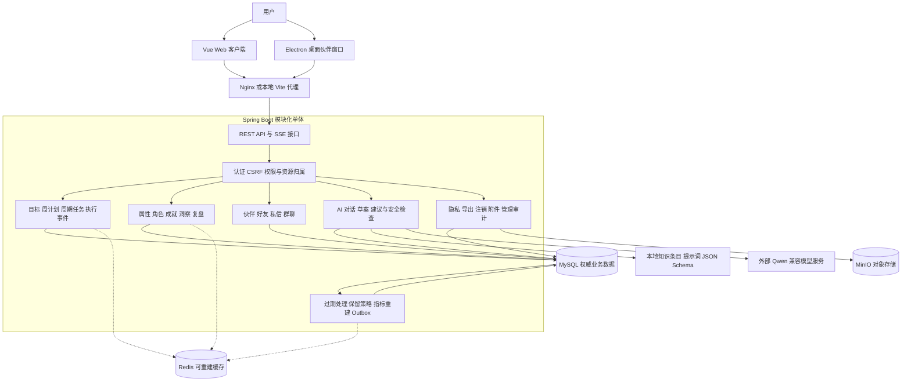

### 4.3 核心数据关系图

图 M04 为主要实体关系的业务抽象，省略字段及部分辅助表，不替代完整数据库定义。关系均围绕当前用户和业务对象建立。

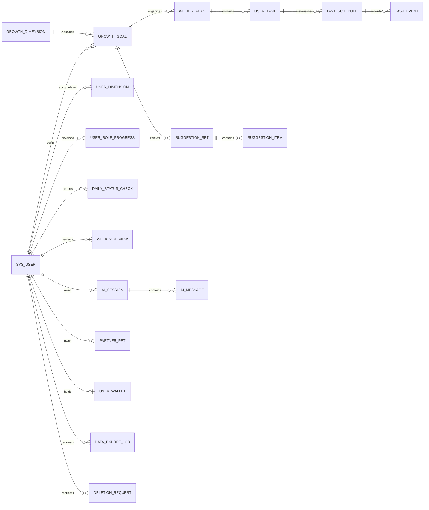

### 4.4 任务一致性设计

系统将“任务定义”“某一天需要执行的任务实例”和“执行事实”分开存储。`user_task` 描述任务及规则，`task_schedule` 表示具体日期的执行安排，`task_event` 记录开始、完成、部分完成、延期、跳过和撤销等事实。这样可以区分“修改以后怎么做”和“过去实际做了什么”。

关键写操作先校验用户归属、幂等键和当前状态，再在事务内完成事件写入、实例状态变更及成长反馈更新。Redis 缓存失效在提交后处理，不以缓存成功作为事实记录成功的前提。撤销不是直接删除旧事件，而是建立反向记录并调整相应增量。当前机制属于状态机、事务与幂等控制的组合，不等同于已证明的全系统事件溯源架构。[E03]

### 4.5 AI 提示词与知识边界

原系统已具备 AI 对话、任务建议和目标草案入口。9 月 16 日进一步增加了系统内知识条目、同会话上下文和草案统一契约，具体边界如下：

1. 知识条目来源于已有代码、路由和迁移，每条保留本地来源；不导入未经核验的外部资料。
2. 任务候选只取当前场景的已发布模板，最多 100 条候选，按请求文字匹配后注入最多 8 条。这是有界本地检索，不宣称使用向量数据库或经过训练的专业领域模型。
3. 请求上下文包括当前用户的规划偏好、启用维度、进行中目标、用户时区当天状态和本会话历史；不读取其他用户或其他会话来构造记忆。
4. 对话历史最多 12 条、合计 12,000 字符。普通对话排除不适合继续生成的高风险历史；目标草案输入仍进行安全判断。
5. 结构化草案校验字段、类型与数量，错误输出最多修复一次，仍失败则返回可恢复错误。提示词只能约束模型行为，不能数学意义上保证每句话真实。
6. 当前安全机制主要基于规则和关键词，存在漏检及误报可能；人工复核、真实模型红队测试和持续评估仍是后续必要工作。[E04]

### 4.6 目标草案 JSON 契约

模型业务输出只使用以下六个字段。`sourceSessionPublicId`、`model` 和 `providerRequestId` 由服务端附加，不应由模型伪造。示例为格式说明，不是实际用户记录。

```json
{
  "title": "四周整理学习记录",
  "description": "建议每周整理三次学习记录，第四周完成总结；频率待确认。",
  "dimensionCode": "KNOWLEDGE",
  "durationDays": 28,
  "weeklyFocus": "先整理要点，再记录仍不清楚的问题。",
  "starterTasks": [
    {
      "title": "整理课堂笔记",
      "estimatedMinutes": 20,
      "difficulty": 2
    }
  ]
}
```

规则为：目标 14—84 天；起步任务 1—3 项；每项 5—60 分钟；难度为 1—3 的整数；维度仅支持 `KNOWLEDGE`、`HEALTH`、`CAREER`、`RELATIONSHIP`、`WELLBEING`。手动任务时长范围更宽，不能直接套用到 AI 草案。现有兼容处理会归一维度别名并收敛整数边界，缺失字段、错误类型或额外字段不会静默填入。[E04]

**【系统截图 S05 待插入】** AI 助手对话页面，使用普通学习规划示例，不展示危机信息或真实隐私。

**【系统截图 S06 待插入】** 同一会话生成的可编辑目标草案与 JSON 预览，突出用户确认入口；9 月 16 日增强机制相关说明单独注明版本日期。

---

## 五 项目创新与竞争分析

### 5.1 创新定位

本项目的创新重点是将个人成长业务组织成可执行、可解释和可纠错的流程，而不是宣称创造了新的大模型、数据库或心理学方法。创新需要以代码、流程、对照实验和用户反馈共同证明。

| 创新方向 | 已有实现基础 | 与单点工具相比的拟改进 | 仍需取得的证据 |
| --- | --- | --- | --- |
| 从目标到执行的连续流程 | 目标、任务定义、实例、事件和复盘相互关联 | 减少计划、打卡和复盘之间的手动搬运 | 与现有习惯的任务完成路径比较 |
| 面向状态变化的温和反馈 | 每日状态、部分完成、延期和撤销 | 允许用户调整节奏，而不是只统计连续成功 | 中断后恢复率、负担感访谈 |
| 可编辑的 AI 业务输出 | 草案表单、结构化建议和确认流程 | 让 AI 回答能够进入已有系统对象 | 字段有效率、采纳前编辑率、人工错误评估 |
| 有边界的系统知识辅助 | 本地来源、已发布模板和上下文约束 | 减少通用回答与实际功能脱节 | 越界建议、虚构功能、提示注入测试集 |
| 成长反馈与自主参与结合 | 属性、角色、伙伴、成就、独自升级 | 提供不同参与方式，而非强制社交比较 | 不同参与方式的真实留存与退出原因 |

### 5.2 替代方案比较

以下是产品类别层面的比较框架，不是对具体品牌的即时测评；不能据此声称其他产品均不具备某项能力。

| 替代方式 | 通常被选择的原因 | 本项目重点验证的不同价值 | 本项目需要面对的不足 |
| --- | --- | --- | --- |
| 纸笔与表格 | 简单、自由、无需复杂账号体系 | 自动生成实例并统一成长记录 | 上手和隐私成本高于纸笔 |
| 待办或日历工具 | 任务记录与时间组织成熟 | 将任务记录与状态检查、复盘关联 | 产品稳定性和生态尚需积累 |
| 习惯记录或游戏化工具 | 即时反馈较明显 | 允许部分完成和纠错，降低单一打卡约束 | 长期激励效果尚未得到证实 |
| 通用 AI 对话工具 | 自然语言交流方便 | 输出与本系统字段、规则和确认流程对接 | 模型仍依赖外部供应商 |
| 学习社群 | 有交流和互助氛围 | 可选择保留私有目标，并将交流与个人记录分开 | 不具备成熟社群运营资源 |

### 5.3 可持续积累方向

后续重点积累三类资产：经真实试点修订的任务与知识内容、可复现的执行与质量评估方法、满足隐私要求的稳定产品体验。不将用户私人对话本身视为可任意使用的“数据壁垒”，不把社区数量、软著申请或开源框架数量作为技术领先的替代指标。

---

## 六 当前成果与验证方案

### 6.1 可核验成果清单

| 成果 | 核验材料 | 当前结论与限制 |
| --- | --- | --- |
| Web 与后端工程 | `frontend`、`backend`、启动配置 | 可运行；不等于完成全部浏览器及移动设备适配验收 |
| 成长业务闭环 | 目标、任务、执行、角色、成就、洞察服务 | 具备实现及测试入口；需按演示清单验证场景 |
| AI 应用链路 | 对话、草案、建议、供应商契约测试 | 已有实现；未在本次材料核验中额外调用真实模型评测 |
| 系统内知识增强 | 本地知识、提示词、Schema 与新增测试 | 9 月 16 日研发期后补充，不倒算研发周期 |
| 社交与伙伴 | 好友、私信、群聊、伙伴和金币服务 | 不属于商业支付或专业情感陪护服务 |
| 数据库结构演进 | `V1` 至 `V16` 迁移文件 | 可核查 16 个文件；不能据此推断每个环境均已完成升级 |
| 本地运行检查 | 9 月 16 日启动与健康检查 | 后端 `UP`、前端正常响应、未登录接口经代理返回预期认证状态 |
| 自动化回归 | 非 Docker 后端测试结果 | 67 项通过；该结果不包含未完成的 Docker 集成测试 |

### 6.2 测试层次与验收口径

| 层次 | 应检查的内容 | 通过标准 |
| --- | --- | --- |
| 单元测试 | 目标周期、状态机、经验、维度、成就、Schema | 明确输入输出与边界，不以“没有报错”代替断言 |
| 数据库集成测试 | 迁移、事务、幂等、数据隔离、注销与导出 | 使用隔离数据库，保留环境和报告 |
| 前端组件测试 | 表单、加载、失败、草案编辑、聊天与设置 | 正常及异常状态均可操作，避免伪成功 |
| 端到端测试 | 注册至复盘的业务闭环、好友与伙伴流程 | 测试数据独立，接口和页面结果一致 |
| AI 质量评估 | 字段有效性、事实边界、用户纠正、风险与注入 | 同时检查 JSON 可解析和语义是否合适 |
| 非功能测试 | 并发、延迟、资源消耗、备份恢复 | 先定义测试环境与门槛，再报告结果 |

此前 Docker 集成测试因当时 Docker 未启动而未完成。后续虽然已启动开发容器与项目服务，但不能据此补写为“集成测试全部通过”。生产压测、渗透测试、恢复演练及真实模型内容质量验证仍列为待完成事项。

### 6.3 试点指标

以下门槛用于下一轮试点决策，不是既有运营数据：

| 指标 | 定义 | 初期目标或使用方法 |
| --- | --- | --- |
| 首次目标激活率 | 完成首个有效目标与至少一项任务配置的人数 ÷ 完成注册的试用人数 | 暂设不低于 60%，同时记录失败原因 |
| D7 留存 | 某日激活队列中，在第 7 日完成一次有效使用的人数 ÷ 该队列激活人数 | 暂设不低于 35%，需说明样本量 |
| 周任务兑现率 | 用户当周已到期、未取消任务中完成或按定义部分完成的比例 | 分用户分布，不仅报告平均值 |
| AI 草案有效率 | 通过结构校验的草案次数 ÷ 实际发起的草案生成次数 | 目标不低于 95%，安全拦截另计 |
| AI 草案错误类型 | 虚构事实、错误任务量、字段问题、越界建议的人工标记 | 分类型统计，不能只看采纳率 |
| 中断后恢复率 | 预先定义的中断用户中，在观察期重新产生有效行动的比例 | 先固定中断与恢复定义，再比较 |
| 服务成本 | 模型与基础设施归集成本 ÷ 活跃或付费用户数 | 按实际账单更新预算 |

**【系统截图 S07 待插入】** 属性或角色成长页，图注明确经验是系统内行为反馈，不是能力鉴定。

**【系统截图 S08 待插入】** 洞察与周复盘页面，使用具有任务记录的演示账号，并注明示例数据。

**【系统截图 S17 待插入】** 同一核心功能的窄屏视口，展示真实响应式效果，不标注为原生移动 App。

**【系统截图 S18 待插入】** 测试报告摘要与健康检查，保留验证日期、测试范围及结果，删除凭据和敏感日志。

---

## 七 商业模式与运营计划

### 7.1 价值交付与收入边界

第一阶段优先验证使用价值，不把“有系统”直接等同于“有可持续生意”。当前版本没有经核验的付费订阅或商业支付链路，伙伴商城中的金币属于系统激励数据，不计作营业收入。

拟探索的路径包括：基础成长管理保持低门槛；在需求得到验证后讨论增值 AI 配额、进阶复盘或组织化活动支持；机构合作必须另行设计权限、数据最小化和服务合同。是否收费、如何收费以及收费对象，由试点结果和合规审查共同决定。

### 7.2 运营方式

1. **招募。** 通过自愿报名、校园活动和同伴介绍邀请小规模试用，不强制以提供私人数据换取参与资格。
2. **激活。** 引导用户完成一个可执行目标，而不是一次性配置大量任务。
3. **反馈。** 每周收集使用阻碍、错误草案、功能缺失和退出原因，优先修复阻断闭环的问题。
4. **留存。** 通过真实复盘帮助用户调整计划，不通过过度提醒、情感依赖或损失惩罚留住用户。
5. **转化。** 在明确成本和需求后测试收费意愿，区分口头愿意付费、试用报名和实际付费。

### 7.3 合作路径

优先联系学校创新创业教育相关单位、学习互助组织或课程实践团队，讨论自愿试点和项目指导。上述是拟联系对象类别，不构成已有合作声明。对外展示的合作名称、标识、证明和数据必须取得授权。

### 7.4 扩展条件

只有在连续试点中观察到可接受的留存、错误率和服务成本，且完成生产安全与合规检查后，才扩大部署。机构后台、多租户、收费、专业辅导和跨学校运营均属于后续产品决策，不直接包装为当前功能。

---

## 八 团队组织与成员分工

### 8.1 组织方式

团队由杨旭光、丁恩鹏、张十全、陈益新、路博勋五人组成，杨旭光担任项目负责人。采用“技术主责＋模块交付＋交叉验收”的方式：高复杂度的架构、事务、安全、AI 约束和跨页面状态主要由杨旭光、丁恩鹏承担；张十全负责伙伴与社交，陈益新负责用户流程与管理功能，路博勋负责成长洞察、周复盘与集成验证，三人均承担明确的模块交付，不将其角色简化为文档辅助。

以下为申报分工整理口径，需与实际贡献证据一致。没有记录支持的个人技术突破、投入时长或完成比例不得补造；本表不涉及尚未确定的股权分配。

### 8.2 五人分工表

| 成员 | 职责定位 | 主责内容 | 难点与责任 | 应对应的成果材料 |
| --- | --- | --- | --- | --- |
| 杨旭光 | 项目负责人、系统架构与核心后端负责人 | 需求范围、架构与数据库；认证权限；目标与周期任务；执行事件、幂等事务和撤销；部署统筹与最终集成 | 跨模块一致性、资源归属、安全边界、接口契约及版本风险，复杂度较高 | 架构与数据模型、迁移文件、核心服务、事务及隔离测试、部署与验收记录 |
| 丁恩鹏 | AI 应用与前端架构负责人 | 前端路由与状态、复杂表单和可视化组件规范；AI 对话、草案与建议衔接；模型适配联调；桌面伙伴集成 | 流式状态、用户纠正、结构化字段、跨页面草案传递、桌面窗口通信，复杂度较高 | 页面与状态设计、AI 交互和供应商契约、草案测试、公共组件与桌面演示；研发期后知识增强另行记账 |
| 张十全 | 成长反馈、伙伴与社交模块负责人 | 伙伴建档与互动、金币兑换、成就称号；好友关系、私信与群聊模块；与核心成长数据联调 | 业务归属、重复奖励、关系状态、未读记录与模块间反馈 | 模块页面和接口、数据表、边界测试、社交与伙伴演示资料 |
| 陈益新 | 用户流程、管理功能与验收材料负责人 | 新手引导、资料偏好、通知和隐私设置；管理端内容与权限页面；用户流程验收、缺陷跟踪、截图和文档 | 新手闭环、异常反馈、管理权限、隐私操作可理解性及材料一致性 | 对应页面和接口联调、验收清单、缺陷记录、操作文档、材料与截图清单 |
| 路博勋 | 成长洞察、周复盘与集成验证负责人 | 成长指标聚合及展示、周复盘读取与编辑确认；在既有架构下完成模块接口与页面联调；自动化回归和测试报告整理 | 统计时间范围、数据来源一致性、复盘状态、空数据与异常场景的可复现验证 | 洞察与复盘模块、指标口径说明、接口及流程测试、回归报告与演示数据说明 |

核心安全与隐私后端由杨旭光把关，陈益新负责相关用户流程、管理页面和验收；AI 模型适配及后台契约由丁恩鹏主责、杨旭光评审。路博勋负责洞察与复盘的业务指标、页面及模块接口，丁恩鹏负责公共可视化组件规范与前端架构评审；自动化回归由路博勋统筹，陈益新跟踪缺陷并整理提交材料。这样既保证复杂任务有明确负责人，也避免模块职责重叠或无人负责。

### 8.3 交叉验收矩阵

| 工作包 | 主责人 | 主要协作与验收人 | 验收重点 |
| --- | --- | --- | --- |
| 架构、数据库与核心接口 | 杨旭光 | 丁恩鹏、陈益新 | 前后端契约、迁移与异常处理 |
| 目标、任务、执行和撤销 | 杨旭光 | 张十全、路博勋 | 经验和金币联动、重复提交与反向操作 |
| AI 对话、草案与复杂前端 | 丁恩鹏 | 杨旭光、陈益新 | 字段、安全、历史上下文、失败状态 |
| 成长、伙伴、成就、社交 | 张十全 | 杨旭光、丁恩鹏 | 数据归属、事务边界和页面联动 |
| 新手、设置、管理与隐私体验 | 陈益新 | 杨旭光、丁恩鹏 | 权限、取消操作、提示和异常路径 |
| 成长洞察与周复盘 | 路博勋 | 杨旭光、丁恩鹏 | 指标来源、时间范围、复盘编辑与确认、图表联动 |
| 自动化回归与集成验证 | 路博勋统筹 | 五人分别提供模块用例，陈益新跟踪缺陷 | 测试环境、范围和结果可复现，不将未执行用例写为通过 |
| 验收材料与截图整理 | 陈益新统筹 | 五人分别提供模块证据，路博勋核对测试摘要 | 演示、报告与实现事实一致 |
| 发布与现场演示 | 杨旭光统筹 | 五人按模块分工 | 环境、密钥、演示账号、降级方案 |

### 8.4 协作与贡献证明

拟采用任务清单、接口约定、版本记录和缺陷闭环作为协作依据。涉及模型输出、账号删除、权限或数据库结构的变更，至少由一名非主责成员复核。交付时不只统计代码行数，应同时保留问题分析、设计决策、测试和联调证据。

指导教师的作用应按真实情况记录为需求讨论、专业方法指导、工程审查或创业指导等，不虚构其投资、资源导入或研究成果。未经本人同意，不填写为指导教师。

---

## 九 研发进度与后续路线

### 9.1 核心研发期

核心研发期为 2026 年 7 月 15 日至 9 月 15 日。下表按两个月周期整理合理的工作分解和阶段验收逻辑；每阶段具体完成日期应与实际提交记录核对，不将计划分解自动视为逐日事实。

| 阶段 | 日期 | 主要工作 | 重点分工 | 阶段交付与核对点 |
| --- | --- | --- | --- | --- |
| 需求与总体设计 | 7 月 15 日—7 月 21 日 | 明确场景、用户流程、数据对象、安全边界 | 杨旭光统筹，丁恩鹏梳理交互；张十全、陈益新整理业务与验收；路博勋梳理统计口径与测试场景 | 需求清单、模块边界、数据模型草案 |
| 基础工程 | 7 月 22 日—7 月 31 日 | 前后端工程、认证、统一接口、迁移、新手与设置基础 | 杨旭光主后端，丁恩鹏主前端；张十全、陈益新交付模块基础；路博勋整理洞察接口与测试数据 | 可启动框架、登录与基础导航 |
| 成长核心闭环 | 8 月 1 日—8 月 14 日 | 目标、周期任务、每日执行、经验与反馈 | 杨旭光主一致性；丁恩鹏主复杂表单；张十全主反馈；陈益新主用户流程验收；路博勋主指标聚合与接口回归 | 从目标创建到执行反馈的闭环 |
| AI 与互动扩展 | 8 月 15 日—8 月 28 日 | 对话、建议、草案；伙伴、成就、好友和消息；洞察与复盘模块开发 | 丁恩鹏主 AI 联调，张十全主互动模块，杨旭光审核接口；陈益新验收并跟踪缺陷，路博勋开发洞察复盘并组织回归 | AI 与手动路径共存，互动及复盘模块具备联调基础 |
| 集成与隐私治理 | 8 月 29 日—9 月 7 日 | 洞察复盘、隐私、导出、注销、管理与桌面联调 | 五人按主责模块集成；杨旭光统筹部署，路博勋主洞察复盘联调与集成验证，陈益新跟踪缺陷 | 集成版本、关键异常与数据隔离检查 |
| 完善与交付 | 9 月 8 日—9 月 15 日 | 修复阻断问题、整理演示与技术文档 | 杨旭光集成把关，丁恩鹏交互复核，张十全业务复核，陈益新验收整理，路博勋整理回归报告与指标说明 | 可运行版本、演示脚本和材料基础 |

### 9.2 研发期后的明确补充

2026 年 9 月 16 日补充了系统内知识库与提示词、普通对话历史、统一草案 Schema、严格字段检查及相关回归。这些内容用于说明当前迭代能力，但在研发周期、贡献统计和成果时间线中单独标识。

### 9.3 后续里程碑

| 阶段 | 时间建议 | 关键任务 | 继续推进条件 |
| --- | --- | --- | --- |
| 参赛核验 | 2026 年 9 月 16 日起，按校赛截止时间安排 | 核验组别、学籍、贡献、截图与成果证据，补跑环境测试 | 无关键事实缺失，无不可解释演示问题 |
| 需求与试用 | 2026 年 10—11 月 | 访谈、问卷和自愿试点；统计使用阻碍与 AI 错误 | 形成真实数据及可执行改进结论 |
| 质量与成本优化 | 2026 年 12 月—2027 年 1 月 | 改进内容质量、性能、安全与成本控制 | 关键故障可定位，单位成本可解释 |
| 合作与收费验证 | 2027 年 2—3 月 | 审慎验证服务模式，补充必要合同及生产能力 | 用户价值、安全和现金流达到内部决策标准 |

赛事提交时间以学校和省赛的实际通知为准，不能只依据全国系统截止日期安排校内材料。[R1]

---

## 十 经费预算与经营测算

### 10.1 预算原则

下列金额为未来六个月小规模验证的**内部测算假设**，并非已支出金额、供应商报价或融资到账。团队现有电脑用于研发，学生研发劳动不计入本表现金支出，但不意味着人力成本不存在。扩展到商业经营时应重新计入工资、税费、渠道、客服及合规成本。

### 10.2 六个月现金预算

| 项目 | 测算方式 | 金额 元 | 说明 |
| --- | --- | ---: | --- |
| 基础计算与网络资源 | 450 元/月 × 6 月 | 2700 | 实际按容量、部署方案和账单调整 |
| AI 调用预留 | 300 元/月 × 6 月 | 1800 | 先设置限额，再按实际使用测算 |
| 域名等基础服务 | 一次性预留 | 150 | 不代表任何供应商固定价格 |
| 存储与备份 | 100 元/月 × 6 月 | 600 | 与基础资源重复计费时相应扣除 |
| 调研及试用激励 | 阶段性预留 | 1000 | 需透明、自愿，不购买虚假好评 |
| 试点活动与材料 | 阶段性预留 | 1200 | 用于真实活动及参赛演示 |
| 素材授权与视觉整理 | 阶段性预留 | 1200 | 仅在授权必要且明确时发生 |
| 安全与合规专业核验 | 专项预留 | 3000 | 正式采购前确定范围与报价 |
| 成果登记与资料整理 | 专项预留 | 1000 | 不是法定收费标准，不代表已登记 |
| 基础预算小计 | 上述合计 | **12650** | 不含团队工资 |
| 预备金 | 预算差额 | **2350** | 经团队确认后使用 |
| 预算总额 | 小计与预备金合计 | **15000** | 六个月计划封顶额度 |

拟通过学校创新创业支持、赛事孵化资源或成员自愿投入解决经费，来源及审批结果需真实记录。没有证据时不填写“已获投资”“已获政府专项资金”。

### 10.3 订阅探索的情景测算

现阶段没有经核验的订阅收入。为判断后续模式是否值得探索，假设未来套餐为每月 18 元，付费用户变动成本为每月 4 元，全部月活跃用户的基础变动成本为每人每月 0.5 元，固定月现金支出为 1000 元。均为情景参数，不是已确定售价或成本。

计算口径：月收入＝月活跃用户数 × 付费转化率 × 18；月现金支出＝1000＋月活跃用户数 × 0.5＋付费用户数 × 4。

| 情景 | 月活跃用户 | 付费转化率 | 付费人数 | 月收入 元 | 月现金支出 元 | 月现金结余 元 |
| --- | ---: | ---: | ---: | ---: | ---: | ---: |
| 谨慎 | 500 | 3% | 15 | 270 | 1310 | -1040 |
| 基准探索 | 1500 | 5% | 75 | 1350 | 2050 | -700 |
| 较好表现 | 4000 | 8% | 320 | 5760 | 4280 | 1480 |

在月活跃用户为 1500 的假设下，达到上述现金口径的收支平衡约需 125 名付费用户，即约 8.33% 的转化率。该测算未包含工资、税费、退款和获客投入，因此即使现金结余为正，也不代表项目已经实现会计利润。试点结果低于假设时，应优先控制范围和成本，而不是修改口径制造盈利。

---

## 十一 数据安全与合规边界

### 11.1 数据与权限

系统通过登录身份、资源归属和接口校验约束用户操作；重要写请求使用 CSRF 保护，管理操作设置角色与 MFA 约束。AI 密钥不下发至前端；密码和会话凭据不得出现在截图、演示录屏或参赛材料中。

个人信息处理应围绕明确目的、必要范围和安全措施开展。本项目把减少传给模型的上下文、提供保留设置、限定导出和注销操作作为工程要求，但不以具备这些接口代替全面合规结论。[R4]

### 11.2 AI 与情绪支持边界

系统的情绪支持场景仅用于一般沟通和日常安排，不用于临床诊断、处方、治疗或紧急救援。高风险内容采用现有固定安全响应或中止生成，不以继续对话延长用户停留。

《人工智能生成合成内容标识办法》已于 2025 年 9 月 1 日施行。当前页面存在 AI 生成提示，但后续对外提供服务仍须核验具体场景下的显式、隐式标识及传播要求，不能只凭一行提示认定已经满足全部要求。[R5]

《人工智能拟人化互动服务管理暂行办法》自 2026 年 7 月 15 日起施行。本项目当前成长伙伴主要是规则驱动的视觉互动，不自动等同于拟人化对话服务；若未来加入持续人格模拟或情感陪伴，应先由合格专业人员判断适用范围并完成相应保护措施，不把这类能力作为未经审查的扩展卖点。[R6]

### 11.3 生产环境仍需完成的事项

- 配置 HTTPS、安全 Cookie、密钥管理、访问限制和数据库备份恢复；当前单机演示不等于生产高可用。
- 对模型供应商的数据处理方式、使用地域、留存方式和必要协议进行核验。
- 完善投诉、人工复核、风险事件响应和 AI 内容质量评估；关键词规则不能代替完整审核。
- 接入邮件或推送服务以及实际恶意文件扫描；当前只具备相关接口、偏好或状态约束。
- 针对未成年用户、敏感信息、注销后备份及社交数据处理进行专项检查，不能宣称已完整解决所有年龄和删除场景。

### 11.4 知识产权与开源使用

仓库包含木兰宽松许可证第 2 版文本，系统也使用第三方框架、图标和伙伴素材。提交前应核对自有贡献、开源依赖、图片动画和字体授权，列明来源及必要署名。未提供登记证书时，不声称已经取得软件著作权或专利；未完成授权核验时，不宣称拥有全部视觉资源的独占权。[E13]

---

## 十二 风险分析与应对

| 风险 | 可能表现 | 当前基础 | 后续应对与责任 |
| --- | --- | --- | --- |
| 需求不成立 | 用户只愿尝试，不愿持续记录 | 已形成可试用闭环 | 访谈和试点优先；杨旭光、陈益新组织问题归因 |
| AI 幻觉或不当建议 | 虚构功能、误读用户、输出不合法 | 规则约束、结构校验、确认入口 | 丁恩鹏维护评估集；杨旭光复核风险边界 |
| 数据一致性 | 重复奖励、撤销后状态不同步 | 事务、幂等、状态机 | 杨旭光与张十全补充并发和逆向测试，路博勋核对统计结果并组织回归 |
| 隐私或越权 | 访问他人记录、暴露聊天或密钥 | 用户归属、管理权限、导出注销接口 | 五人按模块排查；上线前专业核验 |
| 激励设计不当 | 过度使用、刷分或负面比较 | 可调整任务、独自升级 | 不以连续打卡惩罚用户；收集退出和负担反馈 |
| 外部服务成本与故障 | 模型限流、费用超支、消息失败 | 可替换 Provider、手动路径 | 设置预算与降级，定期核对账单 |
| 素材和代码授权 | 资源来源不清，贡献归属争议 | 开源许可证与工程记录 | 建立资源台账、成员确认与引用清单 |
| 团队关键人依赖 | 负责人或 AI 主责缺席影响进度 | 模块分工与交叉验收设计 | 关键接口至少两人可维护，形成运行手册 |
| 参赛材料不一致 | 日期、人数、截图、业绩相互矛盾 | 本文统一五人和两个月口径 | 陈益新统筹证据，路博勋核对测试与指标，杨旭光最终审核 |

风险处理遵循先识别影响、再限制范围、最后扩大功能的原则。未解决的高风险问题应明确记录，不用“后续优化”掩盖会影响真实用户的缺陷。

---

## 十三 育人成效与社会价值

### 13.1 专业学习到工程实践

项目将程序设计、数据库、软件工程、人机交互和信息安全知识应用到同一套系统中。团队需要处理的不只是页面开发，还包括业务状态建模、事务与重复请求、接口契约、错误反馈、模型边界、部署及材料真实性。

杨旭光重点承担架构和工程风险判断；丁恩鹏重点承担 AI 应用与复杂前端协同；张十全在业务模块、数据归属和反馈一致性上形成完整交付；陈益新把用户流程、管理权限、验收与材料串联起来；路博勋围绕成长洞察和周复盘掌握指标定义、数据聚合、模块联调与可复现测试。上述成长应通过本人能够解释的技术决策与交付证据呈现，而不是以统一口号或未经核验的个人奖项代替。

### 13.2 预期社会价值

项目希望降低学生把想法转成行动的组织成本，为自我观察提供连续记录，并形成允许调整、恢复和退出的工具环境。其价值以真实使用反馈为依据，不以诊断情绪、评价人格或强制监督学生为目标。

若后续验证有效，可以形成软件工程课程实践、创新创业训练与校园自愿成长活动的案例。现在尚无证据证明已带动就业、改善心理健康或产生规模化社会收益，因此这些结果不列为既有成绩。

---

## 十四 参赛演示与提交检查

### 14.1 建议演示顺序

| 环节 | 演示内容 | 讲解负责人 | 应回答的问题 |
| --- | --- | --- | --- |
| 问题与总体方案 | 一个具体用户场景、系统闭环与架构 | 杨旭光 | 为什么不是增加一个普通待办列表 |
| 核心行动 | 创建目标、配置任务、执行与受控撤销 | 杨旭光 | 如何避免重复记录和状态错误 |
| AI 应用 | 对话、草案编辑、JSON 预览与确认 | 丁恩鹏 | AI 如何服从已有业务字段，失败如何处理 |
| 成长与互动 | 属性、伙伴、成就或好友交流 | 张十全 | 数据来源是什么，金币是否涉及支付 |
| 洞察与验证 | 成长统计、周复盘、测试范围与结果 | 路博勋 | 指标如何计算，结果如何复现，哪些测试尚未完成 |
| 用户保障与计划 | 设置、隐私、验收边界与后续计划 | 陈益新 | 用户如何控制数据，哪些能力仍需完善 |

使用独立演示账号，事先准备手动路径和确定性示例。演示时若使用 Mock 输出或预先录制视频，应明确说明，不伪装为实时模型响应。

### 14.2 提交前核对清单

**组别条件核验：** 2026 年高教主赛道要求每队 3—15 人，且均为实际核心成员；本项目五人团队符合人数范围，但这不等于已满足全部报名条件。创意组还涉及通知下发前的登记注册状态、负责人及成员学籍等要求；本科生组与研究生组的条件不同，须由学校结合五人的真实信息确认。[R1]

- [ ] 学校、学院、专业、年级、联系方式和指导教师已填写并获确认。
- [ ] 成员学籍、年龄、项目主体和企业注册信息符合所选赛道组别要求。
- [ ] 五名成员均有实质贡献证据，分工与实际提交、测试及演示相符。
- [ ] 核心研发周期为 7 月 15 日至 9 月 15 日，9 月 16 日补充内容已单独标明。
- [ ] 不使用仓库旧文档中的六人或四周表述。
- [ ] 功能、测试、用户、合作、收入、知识产权和奖项均有对应证据或明确为规划。
- [ ] 所有系统截图均为本系统真实页面，示例数据有标注，敏感信息已脱敏。
- [ ] Mermaid 图已渲染为可读图形，不把源代码围栏直接当作最终上传图片。
- [ ] 最终 PDF 或 Word 仅一个文件，大小不超过 20 MB，图表与文字均清晰。
- [ ] 上传后已按界面要求下载检查，无缺页、截断、图像模糊或未替换占位项。

---

## 附录 A 各功能数据流转图

本附录为面向工程说明的数据流转图，使用 Mermaid 流程图表达输入、处理、存储、输出与关键控制点，不声称采用严格的传统 DFD 全套符号。各图中的数据库名称对应真实表；异常分支只列与该功能最相关的情况，所有受保护接口还需经过公共认证与权限层。

节点说明：方框表示界面或处理逻辑，菱形表示判断，圆柱表示持久化数据；虚线表示可选操作、辅助更新或需要补齐的生产环节。除明确标识的后续规划外，图中功能依据当前代码编制。

### A01 账户注册 登录与会话

**输入与处理：** 用户提交账户信息或凭据；服务端校验输入、同意记录和账号状态，创建或轮换会话。密码不能以明文保存，认证 Cookie 不等于所有业务资源的访问许可。

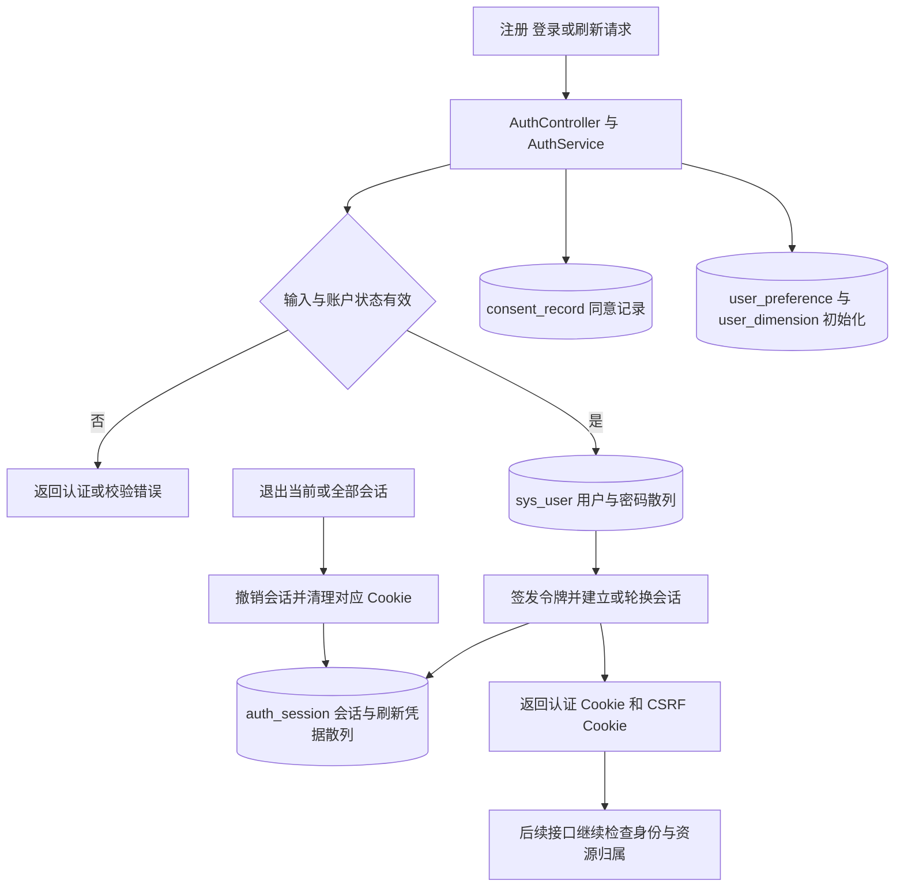

**落库与输出：** 返回会话结果和用户可访问的界面；退出后不应继续接受已撤销会话。实现依据：`AuthService`、`DatabaseSessionService`、`SecurityConfig`。[E05]

### A02 密码维护与管理员 MFA

**输入与处理：** 修改密码需确认当前身份；找回密码使用受控重置令牌；管理员敏感操作还需经过既有权限及 MFA 检查。邮件服务的正式交付适配仍需核验，不宣称找回邮件已在所有环境可用。

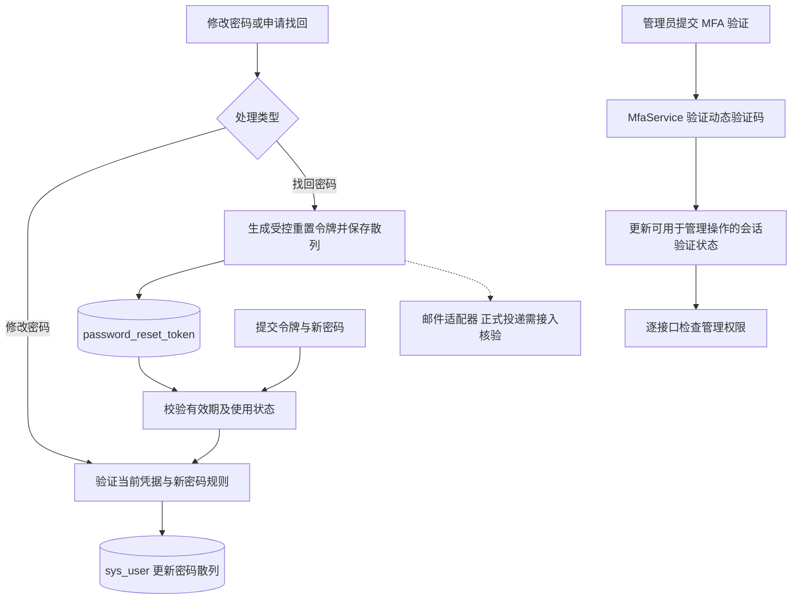

**边界：** 密码维护、会话轮换和 MFA 是不同控制点，不能以普通用户登录成功代替管理权限验证。[E05][E11]

### A03 新手引导与初始奖励

**输入与处理：** 用户选择场景、可投入时间、频率、难度和起步模板。服务端检查模板属于该场景，并锁定用户引导状态，避免重复初始化。

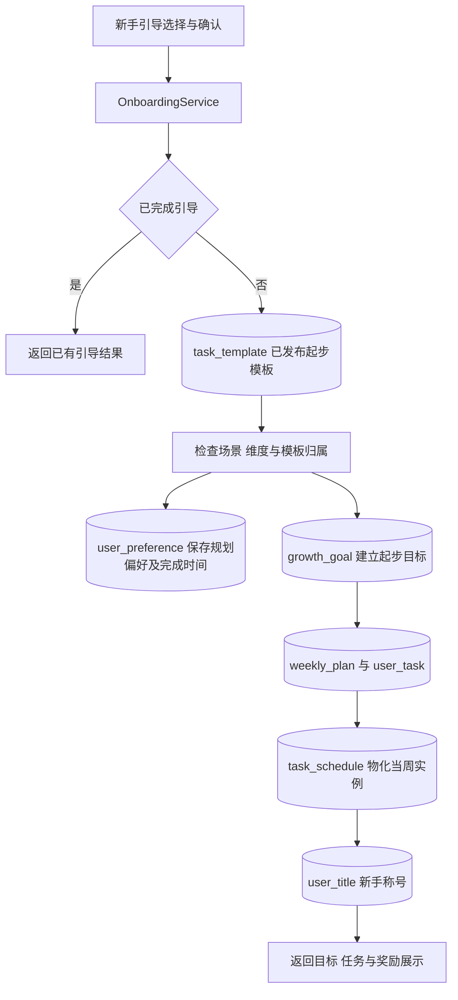

**输出与边界：** 返回可开始执行的初始计划，不把重复打开引导视为再次发放奖励。实现依据：`OnboardingService`。[E06]

### A04 成长维度与阶段目标

**输入与处理：** 用户选择维度、填写目标与起止日期；系统检查维度可访问性、14—84 天周期以及同时最多 3 个进行中目标。自定义维度和五个系统维度应区分，AI 草案不直接支持任意自定义维度码。

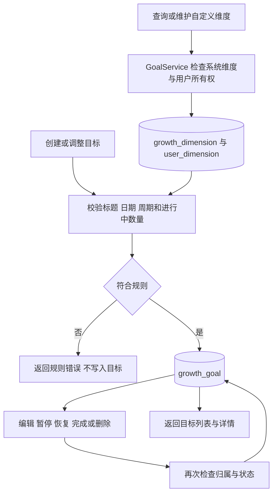

**边界：** 删除和归档按实际服务处理，不假设所有关联历史记录都会被物理删除。实现依据：`GoalService`、`GoalPolicy`。[E03]

### A05 周计划管理

**输入与处理：** 用户为所属目标创建某一周的安排，并提供周起始日期、时区等信息。周计划承接目标和任务，不直接代表任务已经执行。

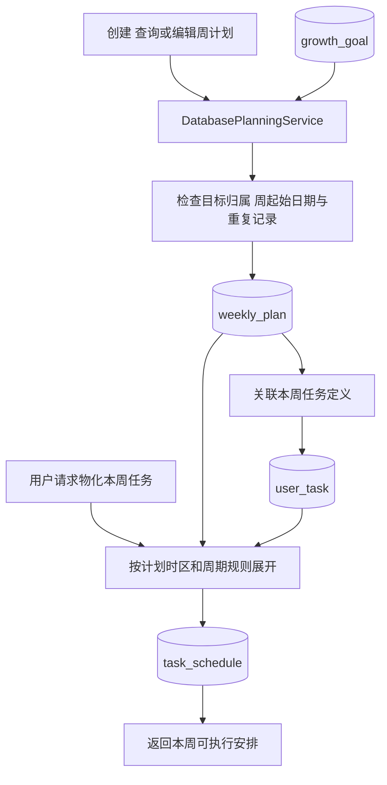

**边界：** 重复物化不应生成相同的重复安排；任务定义与实例状态分开处理。[E03]

### A06 任务创建 修改与周期展开

**输入与处理：** 用户提交任务标题、时长、难度、计划时间、有效期、维度权重和可选重复规则。系统支持周计划关联和目标关联路径，内部完成对应计划组织与实例生成。

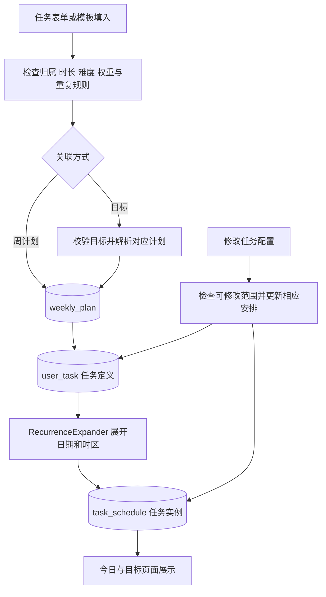

**边界：** 手动任务时长为 5—240 分钟；AI 起步任务为 5—60 分钟。不得把重新生成安排等同于覆写过去执行事实。[E03]

### A07 任务模板抽取与换一批

**输入与处理：** 用户选择职业角色，服务端映射场景，仅从已发布模板中抽取候选；按用户当地日期保存抽取结果和刷新次数。

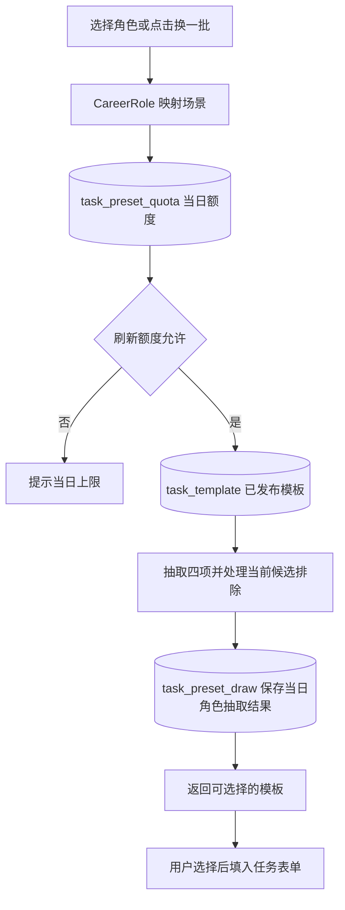

**边界：** 当前每日换一批上限为 3 次；浏览模板不等于已创建任务。实现依据：`TaskPresetService`。[E03]

### A08 每日状态检查

**输入与处理：** 用户记录精力和可用时间。服务根据当前状态生成 `SHRINK`、`KEEP` 或 `LIGHT` 建议，保存为用户日期对应的状态，不自动修改全部任务。

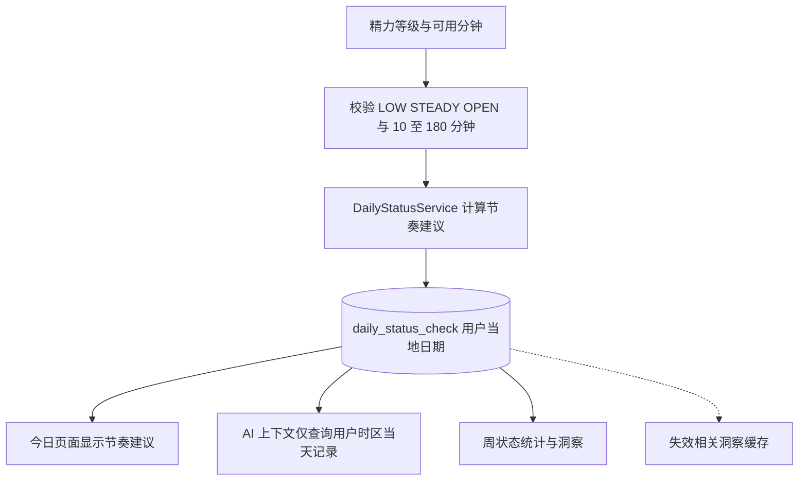

**边界：** 精力和时间为用户自述，不属于诊断数据；缺少当天状态时不沿用旧记录冒充今日状态。[E03][E04]

### A09 今日任务执行与结算

**输入与处理：** 用户对某个任务实例提交操作和幂等键；服务端锁定相关记录、检查状态与上限后结算。延期可形成新的安排，跳过与部分完成不等于完整完成。

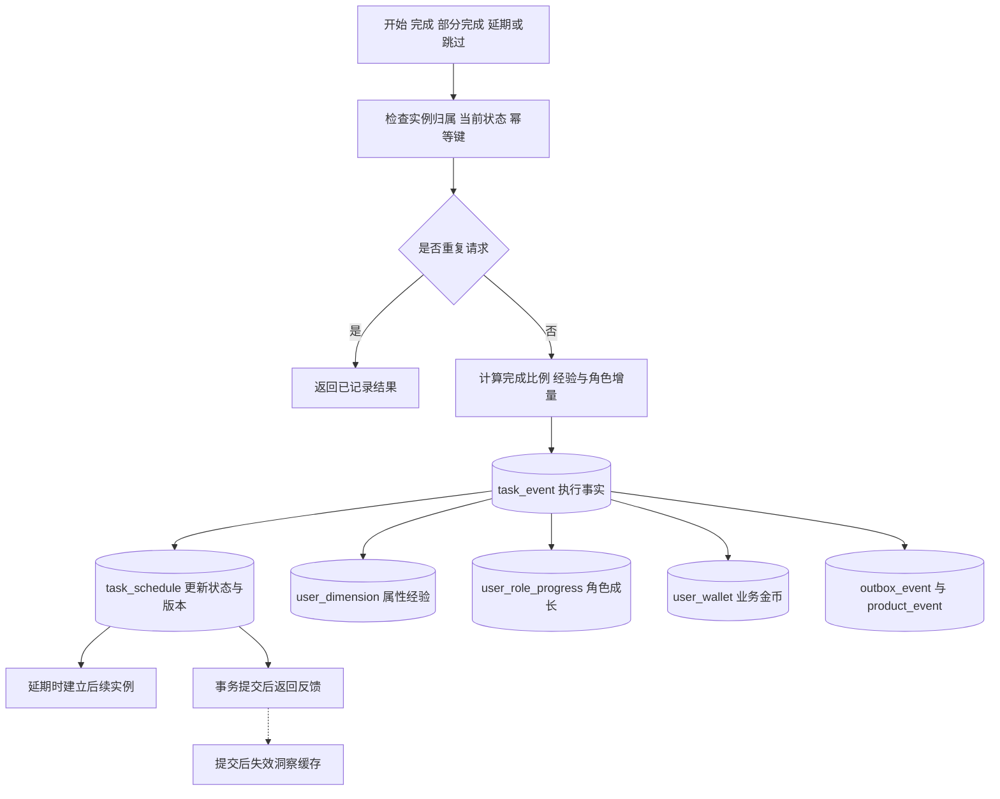

**边界：** 图中更新由服务层事务组织，不表示多个异步微服务；Outbox 不等于已经接入外部消息队列。[E03][E09]

### A10 执行撤销与纠错

**输入与处理：** 用户选择可撤销事件，服务校验归属、可逆条件及幂等键；建立反向事件而不是直接抹除原记录。

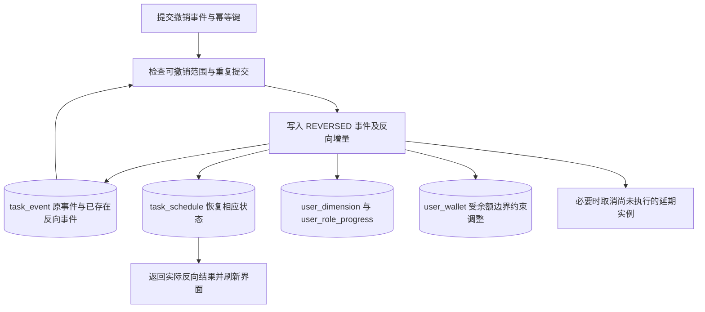

**边界：** 金币和角色存在自身边界约束，不宣称任意历史状态均可无限次完全恢复；需用逆向测试检查实际增量。[E03][E09]

### A11 成长属性与职业角色

**输入与处理：** 任务结算将经验分配到相关维度并更新角色进度；页面查询当前用户的维度和职业角色进展。

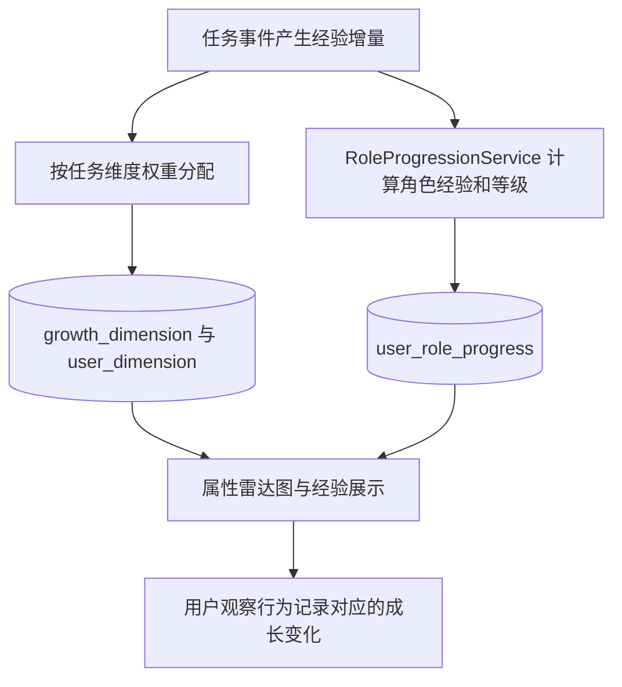

**边界：** 五个系统维度和四类角色分别表示不同概念；经验是产品反馈，不代表学习能力、身体健康或心理状态的专业评估。[E03][E07]

### A12 成就解锁与称号佩戴

**输入与处理：** 系统读取用户实际指标和成就定义，判断是否满足规则；符合条件时记录成就并按定义发放称号。用户可选择已有称号展示。

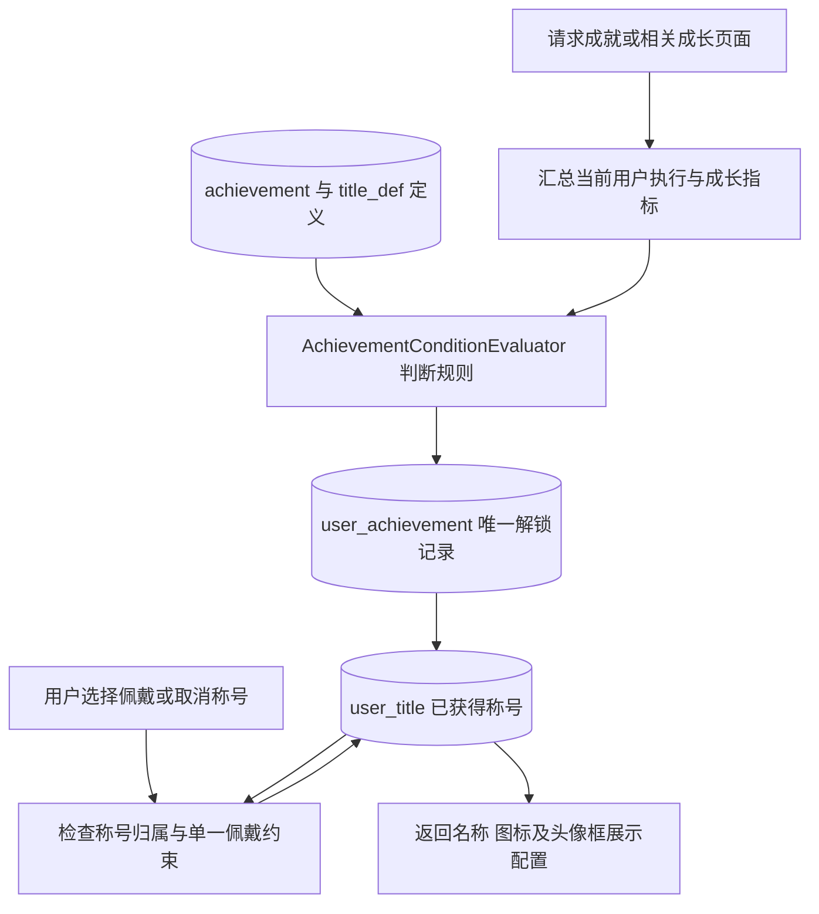

**边界：** 不把页面读取触发的评估描述为独立实时推送系统；已获得成就与当前指标之间的回退策略应以服务实现为准。[E07]

### A13 成长洞察

**【系统截图 S09 待插入于本节之前】** 成就与称号页面，展示真实解锁状态、佩戴操作和展示结果，对应上一节 A12。

**输入与处理：** 用户请求洞察，服务聚合任务、执行、维度和角色等当前用户数据，必要时利用可重建缓存返回视图模型。

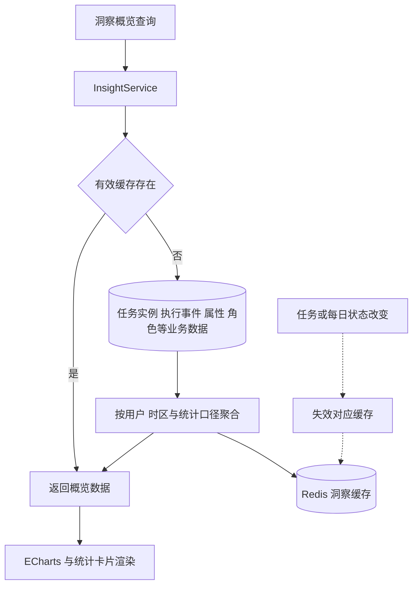

**边界：** 统计口径和样本范围必须明确，不能把任务数量等同于真实学习效果。缓存异常不得改变权威执行记录。[E08]

### A14 周复盘与计划调整

**输入与处理：** 用户选择所属周计划，服务读取计划和当周任务执行数据，计算复盘指标并保存复盘内容；已有复盘按照当前服务规则读取或更新。

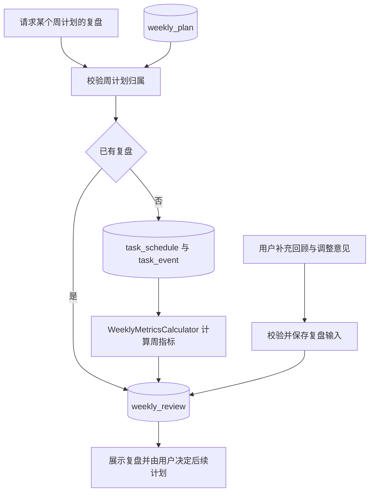

**边界：** 复盘不会自动替用户更改全部目标；自动指标与用户反思应分别展示。[E08]

### A15 AI 会话与安全响应

**输入与处理：** 用户创建场景会话并提交消息。当前服务先检查输入风险，再获取模型输出；正常模型增量在服务端收集并经过输出检查后发送给客户端。

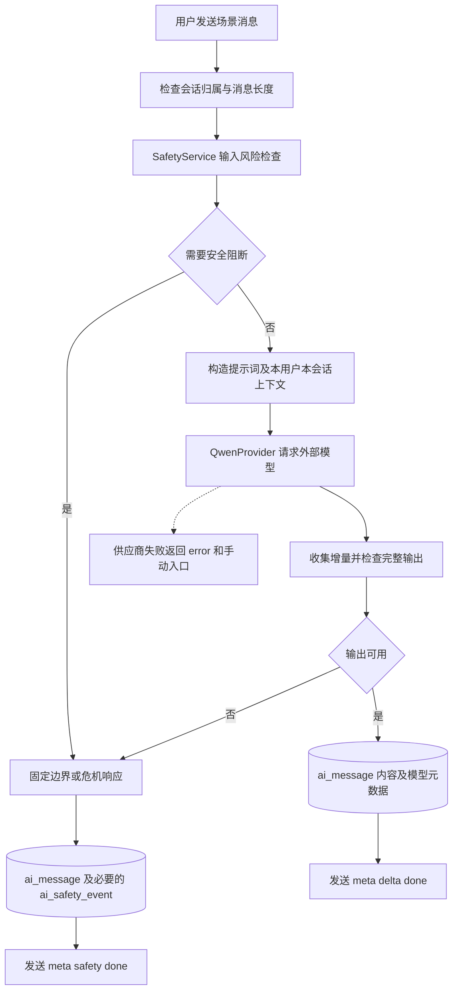

**边界：** 不将当前缓冲后发送的 SSE 实现宣传为未经审核的逐 token 即时推送；AI 消息不直接改变目标。上下文增强属于研发期后完善。[E04]

### A16 系统知识与上下文检索

**输入与处理：** 由场景和用户问题选择本地知识与已发布模板；个人上下文在服务端按当前用户查询，业务文本作为数据而不是高优先级指令。

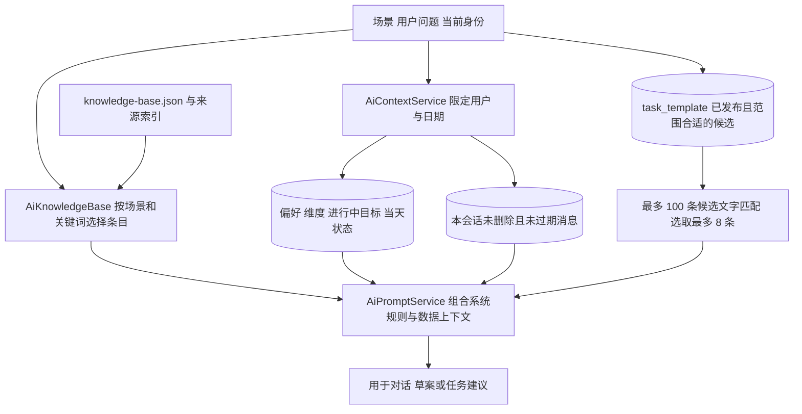

**边界：** 此图对应 9 月 16 日新增机制；不是外部联网搜索或向量 RAG。数据库中的 `knowledge_source` 表不等于本地知识资源已经具备完整后台编辑和向量索引能力。[E04]

### A17 AI 目标草案与目标创建衔接

**输入与处理：** 用户在当前会话点击生成草案；系统校验归属和历史内容，使用统一 Schema 生成并校验六字段结果，再交由用户编辑。

```mermaid
flowchart TD
    CLICK["根据对话生成目标草案"] --> OWNER["检查会话所有权与有效用户消息"]
    OWNER --> INPUT["输入安全检查与系统上下文"]
    INPUT --> MODEL["生成六字段 JSON"]
    MODEL --> CHECK{"字段 类型 数量可接受"}
    CHECK -->|否| REPAIR["最多修复一次 仍失败返回错误"]
    REPAIR --> VERIFIED["仅接受校验成功结果"]
    CHECK -->|是| VERIFIED
    VERIFIED --> SAFETY["对解码后文本执行输出安全检查"]
    SAFETY --> EDIT["返回草案 用户编辑并预览 JSON"]
    EDIT --> LOCAL[("sessionStorage 暂存跨页面草案")]
    LOCAL --> FORM["目标表单再次确认并提交"]
    FORM --> SAVE[("growth_goal 及后续计划任务")]
```

**边界：** 生成草案阶段不创建目标；页面后续提交可能分步完成，任务失败必须如实提示，不能把整个过程宣称为一个跨前后端原子事务。[E04]

### A18 AI 任务建议与幂等采纳

**输入与处理：** 用户选择真实所属目标并提出请求。模型建议通过范围、维度、时间和安全检查后保存为建议集；用户另行选择并采纳。

```mermaid
flowchart TD
    UI["目标与任务建议请求"] --> GOAL["读取所属有效目标和上下文"]
    GOAL --> MODEL["生成 items 结构化任务建议"]
    MODEL --> VALID["校验时长 难度 维度 时间与安全"]
    VALID --> SET[("suggestion_set 与 suggestion_item")]
    SET --> REVIEW["用户查看并选择建议"]
    REVIEW --> ADOPT["提交周计划与 Idempotency-Key"]
    ADOPT --> CHECK["检查所有权 有效期与采纳状态"]
    CHECK --> TASK[("user_task 创建实际任务")]
    TASK --> MARK["关联已创建任务并更新建议集状态"]
    MARK --> SET
    MARK --> RESULT["重复采纳请求返回原结果"]
```

**边界：** 建议集状态字段不等于用户已经授权创建任务；只有独立采纳请求触发正式任务写入。[E04]

### A19 成长伙伴建档与选择

**输入与处理：** 用户创建、修改或选择伙伴。服务检查种类和用户归属，保存显示属性；查询资料时按现有逻辑确保基础钱包与初始伙伴存在。

```mermaid
flowchart TD
    UI["创建 修改或选择伙伴"] --> SERVICE["PartnerService 校验种类与归属"]
    SERVICE --> PET[("partner_pet 名称 种类 外观和选中状态")]
    PROFILE["读取伙伴资料"] --> INIT["必要时初始化钱包与初始伙伴"]
    INIT --> PET
    INIT --> WALLET[("user_wallet")]
    PET --> RESULT["返回伙伴资料及可用展示信息"]
    WALLET --> RESULT
    ASSET["前端伙伴图像与动画资源"] --> VIEW["伙伴页面和桌面窗口渲染"]
    RESULT --> VIEW
```

**边界：** 伙伴图像和行为反馈不等于具有自主认知或医疗支持能力。[E09]

### A20 每日伙伴互动

**输入与处理：** 用户点击与所属伙伴互动，服务按照账号时区确定当天日期，用记录约束避免同一天重复累加同类奖励。

```mermaid
flowchart TD
    CLICK["点击伙伴互动"] --> OWNER["校验伙伴所属用户"]
    OWNER --> DATE["计算用户当地日期"]
    DATE --> RECORD[("partner_interaction 当日互动记录")]
    RECORD --> FIRST{"本次是否新增当日记录"}
    FIRST -->|是| REWARD["计算亲密度与等级变化"]
    FIRST -->|否| TIME["仅按现有逻辑更新互动时间"]
    REWARD --> PET[("partner_pet")]
    TIME --> PET
    PET --> RESULT["返回实际互动结果"]
```

**边界：** 不宣称每次点击都会获得奖励，也不把互动频次转换成真实情感关系。[E09]

### A21 业务金币与伙伴商城兑换

**【系统截图 S10 待插入于本节之前】** 伙伴资料及每日互动结果，对应 A19—A20；使用演示账号，不编造互动次数。

**输入与处理：** 任务结算产生业务金币增量；兑换时锁定钱包并检查物品、伙伴归属和余额，在事务中扣减金币并更新亲密度。

```mermaid
flowchart TD
    EVENT["任务经验增量或反向增量"] --> COIN["按现有规则换算金币并限制余额范围"]
    COIN --> WALLET[("user_wallet")]
    UI["选择伙伴与商城物品"] --> VALID["校验物品有效性 归属与余额"]
    ITEMS[("partner_shop_item")] --> VALID
    WALLET --> VALID
    VALID --> BUY["事务内扣减金币并计算亲密度"]
    BUY --> WALLET
    BUY --> PET[("partner_pet")]
    BUY --> PURCHASE[("partner_purchase 兑换记录")]
    PURCHASE --> RESULT["返回余额 物品和伙伴状态"]
```

**边界：** 本图没有银行卡、充值、提现或支付网关，不能作为商业交易或收入证明。[E09]

### A22 桌面伙伴与本地窗口设置

**【系统截图 S11 待插入于本节之前】** 商城兑换前后金币余额及道具状态，对应上一节 A21，明确金币是系统内激励单位。

**输入与处理：** 用户选择桌面伙伴时，前端将所选伙伴的 `petPublicId` 保存到本地；打开、关闭及调整窗口等行为通过受控 IPC 交由 Electron 主进程处理，不将这些窗口操作全部视为已持久化偏好。

```mermaid
flowchart TD
    UI["桌面伙伴设置界面"] --> STORE["保存所选伙伴标识"]
    STORE --> LOCAL[("localStorage 中的 petPublicId")]
    UI --> IPC["窗口操作经预加载桥与受控 IPC 调用"]
    IPC --> MAIN["Electron 主进程"]
    MAIN --> WINDOW["打开 关闭 调整伙伴与设置窗口"]
    LOCAL --> PET["桌面伙伴页面读取所选伙伴"]
    WINDOW --> PET
    ASSET["本地图像或动画资源"] --> PET
    PET --> DISPLAY["桌面显示与交互"]
```

**边界：** 所选伙伴的本地记录不自动成为云端账号配置；不据此声称窗口状态全部持久化。跨设备同步和全部平台发行签名不在当前成果声明内。[E02]

### A23 好友搜索 申请与关系维护

**【系统截图 S12 待插入于本节之前】** Electron 桌面伙伴与设置窗口，对应上一节 A22，不以普通网页代替桌面运行效果。

**输入与处理：** 用户搜索其他用户或提交申请，服务检查身份、关系与隐私状态。对申请执行接受、拒绝或关系维护时再次校验参与双方。

```mermaid
flowchart TD
    SEARCH["搜索用户或查看好友列表"] --> PRIVACY["FriendService 检查可发现性与访问范围"]
    USER[("sys_user 与 user_preference 隐私字段")] --> PRIVACY
    PRIVACY --> RESULT["返回允许展示的用户摘要"]
    APPLY["发送好友申请"] --> CHECK["检查目标 自我申请与已有关系"]
    CHECK --> RELATION[("friend_relationship")]
    ACTION["接受 拒绝或删除关系"] --> OWNER["校验关系参与者与状态"]
    OWNER --> RELATION
    RELATION --> FRIENDS["返回好友关系与允许访问的摘要"]
```

**边界：** 独自升级影响可发现性和相关访问行为；不得由“存在好友关系”推断可以读取对方全部任务或 AI 内容。[E10]

### A24 好友私信与未读处理

**输入与处理：** 用户发送文本，服务检查好友关系和消息限制后写入记录；界面通过接口轮询获取消息并标记已读。

```mermaid
flowchart TD
    SEND["提交私信文本与对方标识"] --> CHECK["校验好友关系 内容和访问范围"]
    RELATION[("friend_relationship")] --> CHECK
    CHECK --> MESSAGE[("friend_message")]
    POLL["页面定时轮询消息"] --> QUERY["按当前用户与对方查询"]
    MESSAGE --> QUERY
    QUERY --> VIEW["合并消息并显示对话"]
    VIEW --> READ["提交已读操作"]
    READ --> MESSAGE
    MESSAGE --> UNREAD["会话摘要与未读提示"]
```

**边界：** 当前页面轮询间隔为约 4 秒，不是 WebSocket 长连接即时通信。[E10]

### A25 群组 群聊与成员状态

**输入与处理：** 用户创建或进入群组，服务校验成员资格与可执行操作；群消息按群组和用户权限读取，已读位置保存到成员记录。

```mermaid
flowchart TD
    CREATE["创建群组或维护成员"] --> VALID["FriendGroupService 检查用户与成员权限"]
    VALID --> GROUP[("friend_group")]
    VALID --> MEMBERS[("friend_group_member")]
    SEND["提交群消息"] --> MEMBER["检查当前用户仍为有效成员"]
    MEMBERS --> MEMBER
    MEMBER --> MESSAGE[("friend_group_message")]
    POLL["群页面轮询"] --> ACCESS["限定群组与成员范围读取"]
    MEMBERS --> ACCESS
    MESSAGE --> ACCESS
    ACCESS --> VIEW["显示消息并提交已读位置"]
    VIEW --> MEMBERS
```

**边界：** 群成员关系与好友关系属于不同授权条件；不能假设任意好友都可读取任意群历史。[E10]

### A26 资料 偏好 独自升级与外观

**【系统截图 S13 待插入于本节之前】** 好友申请、私信和群聊的组合截图，对应 A23—A25；仅使用演示账号和示例消息。

**输入与处理：** 用户维护资料、规划偏好、同意状态与隐私设置；外观偏好走本地状态存储，与服务端个人资料区分。

```mermaid
flowchart TD
    PROFILE["个人资料与规划设置"] --> VALID["IdentityService 检查字段和当前用户"]
    VALID --> USER[("sys_user")]
    VALID --> PREF[("user_preference")]
    CONSENT["同意设置与 AI 记忆开关"] --> CONSENTSTORE[("consent_record 与 user_preference")]
    SOLO["启用独自升级"] --> PRIVACY["更新隐私偏好"]
    PRIVACY --> PREF
    PREF --> SOCIAL["好友发现与访问流程读取隐私状态"]
    THEME["主题 背景及动效偏好"] --> APPEARANCE["appearance.store"]
    APPEARANCE --> LOCAL[("localStorage")]
    LOCAL --> RENDER["当前设备界面应用外观"]
```

**边界：** AI 记忆开关与本会话历史上下文不是同一机制；不宣称开启后自动完成跨会话长期记忆学习。[E05][E10][E02]

### A27 通知偏好与待投递记录

**【系统截图 S14 待插入于本节之前】** 隐私及独自升级设置，对应上一节 A26，展示开关含义和保存反馈。

**输入与处理：** 用户设置通知渠道、开关和限额。通知服务根据时区、免打扰时段、去重键和当日投递记录决定是否创建待投递记录。

```mermaid
flowchart TD
    UI["设置渠道开关与限额"] --> PREF[("notification_preference")]
    EVENT["业务请求安排通知"] --> CHECK["检查渠道 偏好 去重与每日限额"]
    PREF --> CHECK
    USERPREF[("user_preference 时区与免打扰时间")] --> CHECK
    CHECK --> TIME["计算允许通知的时间"]
    TIME --> DELIVERY[("notification_delivery 待投递记录")]
    DELIVERY -.-> ADAPTER["实际邮件或推送适配器 生产待接入"]
    ADAPTER -.-> RESULT["真实投递结果需回写并监测"]
```

**边界：** 保存通知设置或 `PENDING` 记录不能作为邮件、短信或推送已经送达的证明。[E05]

### A28 数据导出与下载

**输入与处理：** 用户请求导出，服务检查归属、幂等和频率限制，读取当前导出范围，生成带清单及校验值的压缩包并存入对象存储。

```mermaid
flowchart TD
    UI["申请导出并提交幂等键"] --> CHECK["检查身份 频率与重复请求"]
    CHECK --> DATA[("资料 目标 执行事件 角色进度")]
    DATA --> ZIP["生成 manifest JSON 与 CSV 压缩包"]
    ZIP --> STORAGE[("对象存储 导出文件")]
    ZIP --> JOB[("data_export_job 状态 校验值 有效期")]
    DOWNLOAD["请求下载导出文件"] --> ACCESS["检查归属 READY 状态及有效期"]
    JOB --> ACCESS
    ACCESS --> STORAGE
    STORAGE --> RESULT["提供受控下载结果"]
```

**边界：** 当前导出覆盖资料、目标、执行事件和角色进度，不宣称已导出所有聊天、伙伴和后台数据；文件过期需按现有作业处理。[E12]

### A29 账号注销与取消

**输入与处理：** 用户发起注销后进入冷静期；允许的阶段可取消。到期作业处理受覆盖数据并匿名化账号，生成完成状态。

```mermaid
flowchart TD
    UI["申请注销"] --> REQUEST[("deletion_request 冷静期记录")]
    REQUEST --> STATE[("sys_user 更新账号状态")]
    CANCEL["冷静期内取消"] --> CHECK["检查仍可取消"]
    CHECK --> REQUEST
    CHECK --> ACTIVE["恢复允许的账号状态"]
    ACTIVE --> STATE
    JOB["定时检查到期请求"] --> DUE["锁定到期记录并进入处理"]
    REQUEST --> DUE
    DUE --> CLEAN["清理已覆盖 AI 内容 标记附件并匿名化账号"]
    CLEAN --> STATE
    CLEAN --> RECEIPT["保存完成状态与回执散列"]
    RECEIPT --> REQUEST
```

**边界：** 当前代码不能被描述为已完成所有数据库表、对象文件、备份和第三方副本的物理删除；上线前应补充完整数据清单与处理核验。[E12]

### A30 AI 数据保留与记忆删除

**【系统截图 S15 待插入于本节之前】** 导出请求状态、演示导出结果及注销取消入口，对应 A28—A29；不对真实账号执行不可恢复操作。

**输入与处理：** 用户设置 AI 数据保留天数或请求删除所属记忆记录；保留作业根据有效期处理到期内容。

```mermaid
flowchart TD
    UI["修改 AI 保留设置"] --> VALID["校验允许的保留天数"]
    VALID --> PREF[("user_preference")]
    PREF --> WRITE["新消息等按策略设置有效期"]
    WRITE --> MESSAGE[("ai_message")]
    DELETE["删除所属记忆记录"] --> OWNER["按用户和公开标识限制更新"]
    OWNER --> MEMORY[("ai_memory 标记删除")]
    JOB["RetentionJob 扫描到期数据"] --> MESSAGE
    JOB --> MEMORY
    MESSAGE --> HISTORY["上下文查询排除删除和过期记录"]
```

**边界：** 提供保留和删除接口不代表已经启用自动长期记忆；新旧数据的策略变更效果应按实际实现验证。[E04][E12]

### A31 附件预签名与执行记录关联

**输入与处理：** 用户提交文件类型、扩展名和大小，服务校验后创建附件记录并返回短时上传地址。与任务事件关联前必须检查归属和扫描状态。

```mermaid
flowchart TD
    UI["提交附件元信息"] --> POLICY["AttachmentPolicy 检查类型 扩展名与大小"]
    POLICY --> RECORD[("attachment 元数据与扫描状态")]
    POLICY --> URL["对象存储生成短时预签名上传地址"]
    URL --> UPLOAD["客户端上传文件"]
    UPLOAD --> STORAGE[("MinIO 或 S3 兼容对象存储")]
    STORAGE -.-> SCAN["实际恶意文件扫描服务 待接入"]
    SCAN -.-> RECORD
    ASSOCIATE["申请关联任务事件"] --> CHECK["检查附件归属 事件归属与 CLEAN 状态"]
    RECORD --> CHECK
    TASK[("task_event")] --> CHECK
    CHECK --> RECORD
```

**边界：** 不绕过扫描状态，也不把状态字段存在等同于实际扫描器已上线。[E12]

### A32 管理员账号 权限与审计

**输入与处理：** 管理员操作首先经过角色、权限和 MFA 要求检查，再执行允许的账号管理变更并记录审计信息。

```mermaid
flowchart TD
    ADMIN["管理员查询或管理账号"] --> AUTH["AdminAuthorizationService 权限与 MFA 检查"]
    AUTH --> ALLOW{"具备所需管理权限"}
    ALLOW -->|否| ERROR["拒绝操作"]
    ALLOW -->|是| SERVICE["AdminUserService 校验管理规则"]
    SERVICE --> USER[("sys_user 角色与状态")]
    SERVICE --> AUDIT[("audit_log 操作者 动作与请求标识")]
    USER --> RESULT["返回最小必要管理视图"]
    AUDIT --> TRACE["供后续检查操作来源"]
```

**边界：** 管理角色不是任意读取所有私密业务内容的授权；日志不得保存密码、完整令牌或模型密钥。[E11]

### A33 提示词治理与知识维护

**输入与处理：** 管理端可对已有场景提示词执行版本发布或回退；本地知识库及草案 Schema 走代码维护和测试，不是同一套后台编辑流程。

```mermaid
flowchart TD
    ADMIN["管理员提交场景提示词版本"] --> AUTH["权限与内容校验"]
    AUTH --> VERSION[("ai_prompt_version")]
    AUTH --> AUDIT[("audit_log 发布或回退记录")]
    VERSION --> CHAT["对话选择已发布场景策略"]
    DEV["维护本地知识条目与 Schema"] --> SOURCE["核对系统源码及本地来源"]
    SOURCE --> TEST["执行知识来源与输出契约测试"]
    TEST --> BUILD["构建并重启后端加载资源"]
    BUILD --> FILE["本地提示词 知识 JSON 与 Schema"]
    FILE --> CHAT
    FILE --> STRUCTURED["目标草案与任务建议构造"]
```

**边界：** 已有发布机制与当前运行选择逻辑均需在正式版本治理中核验；不声称已建立完整在线知识运营平台或自动回滚发布体系。[E04][E11]

### A34 安全事件查看与聚合管理指标

**输入与处理：** 安全链路保存必要事件；有权限的管理员读取脱敏视图。管理概览按现有表统计账号、任务事件、安全事件和注销积压等数量。

```mermaid
flowchart TD
    RISK["安全风险触发相应记录"] --> SAFETY[("ai_safety_event")]
    ADMIN["管理员请求安全视图或指标"] --> AUTH["检查对应管理权限"]
    AUTH --> REVIEW["SafetyReviewService 返回脱敏事件视图"]
    SAFETY --> REVIEW
    AUTH --> METRICS["MetricsController 聚合现有数据"]
    USER[("sys_user")] --> METRICS
    TASK[("task_event")] --> METRICS
    SAFETY --> METRICS
    DELETE[("deletion_request")] --> METRICS
    METRICS --> VIEW["管理概览展示"]
```

**边界：** 当前 `activeUsers` 指账号状态为活跃的数量，不是按日访问统计的 DAU；安全事件查看不等于已经建立完整人工审核工单闭环。[E11]

### A35 后台作业与可靠性辅助

**【系统截图 S16 待插入于本节之前】** 管理员权限内的内容管理与聚合指标页面，对应 A32—A34，隐藏敏感信息，不将 ACTIVE 账号数标为日活。

**输入与处理：** 业务提交生成必要事件或有效期；定时作业处理实例过期、数据保留、导出过期、删除请求、指标重建和 Outbox 状态。

```mermaid
flowchart TD
    BUSINESS["业务事务与有效期设置"] --> DB[("任务实例 AI 数据 导出 注销及 Outbox 记录")]
    TIMER["定时调度"] --> JOB["对应领域后台作业"]
    DB --> JOB
    JOB --> UPDATE["按当前状态与时间执行允许的更新"]
    UPDATE --> DB
    UPDATE -.-> STORAGE["受覆盖的导出文件到期清理"]
    UPDATE -.-> CACHE["指标重建或缓存相关处理"]
    JOB --> FAILURE["保留失败状态或尝试次数供定位"]
```

**边界：** 当前 Outbox 实现具备读取、载荷检查和状态更新，不把它画成已接入 Kafka 或 RabbitMQ 的消息总线。生产调度、告警、恢复和全量清理仍需单独验证。[E12]

---

## 附录 B 系统截图清单

以下位置均应插入真实系统图片。暂不使用虚构效果图、网上产品页面或未实现功能的示意界面冒充成果。Mermaid 图为结构说明，不替代运行截图。

| 编号 | 截图内容 | 建议放置位置 | 截图应体现的事实 |
| --- | --- | --- | --- |
| S01 | 首页或今日页面全景 | 第一章末 | 真实导航、状态与任务入口 |
| S02 | 阶段目标列表与详情 | 第三章 | 目标名称、周期、状态和任务入口 |
| S03 | 任务创建或编辑 | 第三章 | 时长、难度、日期与重复规则 |
| S04 | 每日状态及执行反馈 | 第三章 | 用户输入与服务返回的实际状态 |
| S05 | AI 普通场景对话 | 第四章 | 生成提示、安全边界与模型信息 |
| S06 | 目标草案编辑和 JSON 预览 | 第四章 | 六字段结构、编辑和确认入口 |
| S07 | 属性与职业角色成长 | 第六章 | 行为反馈对应的维度和等级 |
| S08 | 洞察与周复盘 | 第六章 | 示例任务数据形成的统计视图 |
| S09 | 成就称号与佩戴 | 附录 A12 后 | 解锁状态、称号与展示效果 |
| S10 | 伙伴资料与日常互动 | 附录 A19—A20 后 | 伙伴选择、亲密度和实际互动结果 |
| S11 | 商城兑换与金币余额 | 附录 A21 后 | 业务金币兑换，不显示现金支付暗示 |
| S12 | Electron 桌面伙伴 | 附录 A22 后 | 真实桌面窗口，不以网页截图替代 |
| S13 | 好友、私信与群聊 | 附录 A23—A25 后 | 演示账号间交流和未读提示 |
| S14 | 隐私及独自升级设置 | 附录 A26 后 | 用户可理解的隐私选择 |
| S15 | 数据导出与注销流程 | 附录 A28—A29 后 | 状态提示、取消入口或演示导出结果 |
| S16 | 管理员内容与指标页面 | 附录 A32—A34 后 | 权限内管理视图，去除敏感字段 |
| S17 | 响应式移动视口 | 第六章或展示附页 | 同一功能在窄屏下可操作，而非宣称原生 App |
| S18 | 验证报告与健康检查 | 第六章 | 测试范围、日期和结果，不混入密钥日志 |

### 截图处理规范

1. 每张图使用“图 S编号＋具体内容”的图注，避免使用“系统截图一”等无法对应功能的标题。
2. 同一组截图尽量使用相同界面版本、主题与演示账号；必要时注明版本或日期。
3. 提前准备合理的演示任务，既不展示空白页，也不把演示数据描述成真实运营成果。
4. 对邮箱、手机号、私人消息、用户标识和内部配置进行脱敏；模型密钥、密码和令牌不得出现。
5. 宽图转为纵向页面时优先拆分重点，避免把整张屏幕压缩到文字无法辨认。
6. 截图是否压缩以最终清晰度为准，最终文件须满足单份、PDF 或 Word、20 MB 以内的界面要求。

---

## 附录 C 证据索引与参考资料

### C.1 项目内部证据索引

以下路径相对于项目仓库根目录。参赛时可将必要的说明、测试摘要和合法可公开的材料另行整理为校内核验附件，但不得额外上传超过平台数量限制的文件。

| 索引 | 对应证据 | 可支持的内容 |
| --- | --- | --- |
| E01 | `README.md`、`backend/pom.xml`、`frontend/package.json`、`deploy/compose.yaml` | 技术栈、启动方式、开发部署拓扑 |
| E02 | `frontend/src/app/router.ts`、`frontend/desktop/main.cjs`、`frontend/src/modules/partners/desktop-pet.store.ts`、`frontend/src/shared/ui/appearance.store.ts` | 页面边界、桌面窗口、本地外观与伙伴偏好 |
| E03 | `backend/src/main/java/com/betterself/growth/goal`、`backend/src/main/java/com/betterself/growth/execution`、`backend/src/main/java/com/betterself/growth/daily`、`backend/src/main/java/com/betterself/growth/career` | 目标限制、周期任务、执行事件、撤销、状态检查和角色成长 |
| E04 | `backend/src/main/java/com/betterself/growth/ai`、`backend/src/main/java/com/betterself/growth/safety`、`backend/src/main/resources/ai`、`frontend/src/modules/ai`、`docs/api/ai-api.md` | AI 链路、知识来源、Schema、安全与用户确认边界 |
| E05 | `backend/src/main/java/com/betterself/growth/auth`、`backend/src/main/java/com/betterself/growth/identity` | 认证、会话、MFA、资料偏好和通知机制 |
| E06 | `backend/src/main/java/com/betterself/growth/onboarding` | 新手引导与初始化结果 |
| E07 | `backend/src/main/java/com/betterself/growth/achievement`、`backend/src/main/resources/db/migration/V14__achievements_and_titles.sql` | 成就规则、称号获得与佩戴 |
| E08 | `backend/src/main/java/com/betterself/growth/insight`、`frontend/src/modules/insights` | 指标聚合、展示和周复盘 |
| E09 | `backend/src/main/java/com/betterself/growth/partner`、`backend/src/main/resources/db/migration/V8__partner_wallet_shop.sql`、`backend/src/main/resources/db/migration/V9__daily_partner_interaction.sql` | 伙伴、金币、兑换和每日互动 |
| E10 | `backend/src/main/java/com/betterself/growth/social`、`frontend/src/modules/friends`、`backend/src/main/resources/db/migration/V16__solo_growth_privacy.sql` | 好友关系、私信、群聊、轮询和独自升级 |
| E11 | `backend/src/main/java/com/betterself/growth/admin` | 管理权限、提示词版本、审计、安全视图和聚合指标 |
| E12 | `backend/src/main/java/com/betterself/growth/privacy`、`backend/src/main/java/com/betterself/growth/shared/outbox`、`backend/src/test`、`e2e`、`docs/release/known-limitations.md` | 导出、删除、附件、后台作业、测试范围和生产限制 |
| E13 | `LICENSE`、`frontend/public/assets` 内的资源说明 | 开源许可与素材核验入口，不替代逐项授权证明 |

**测试与运行证据说明：** 67 项通过的结论对应 2026 年 9 月 16 日执行的非 Docker 后端回归，命令为 `mvn -o '-Dtest=*Test,!GrowthApplicationTest' test`。本地启动健康检查与该测试为不同证据；提交前应保存当次报告副本，避免后续运行覆盖结果。没有在本计划书制作过程中重新宣称完成全部前端、端到端或生产测试。

### C.2 外部参考资料

引用资料用于赛事口径、教育背景与合规边界，不作为本项目用户需求已验证或产品已合规的证明。访问核验日期统一为 2026 年 9 月 16 日；提交前应再次核对学校当届通知和官方更新。

| 索引 | 资料与发布主体 | 本文使用范围 |
| --- | --- | --- |
| R1 | 教育部关于举办中国国际大学生创新大赛（2026）的通知及附件，全国大学生创业服务网官方发布包 | 高教主赛道方案第 13—15 页：团队人数、创意组与学籍要求；实际安排另须核对校内通知 |
| R2 | 中国国际大学生创新大赛（2026）评审规则；官方发布页日期为 2026 年 8 月 19 日 | 规则第 1—2 页：高教主赛道创意组 30、30、25、15 分及材料真实性要求 |
| R3 | 教育部《2025 年全国教育事业发展统计公报》，2026 年 7 月 6 日发布 | 高等教育毛入学率 61.30% 的背景数据，不直接推导市场收入 |
| R4 | 《中华人民共和国个人信息保护法》，国家互联网信息办公室官网公布文本 | 第六条等：目的明确、必要范围和个人信息保护原则 |
| R5 | 国家互联网信息办公室等《关于印发〈人工智能生成合成内容标识办法〉的通知》，2025 年 3 月 14 日发布 | AI 内容标识适用范围与核验方向；第十四条规定 2025 年 9 月 1 日起施行 |
| R6 | 国家互联网信息办公室等《人工智能拟人化互动服务管理暂行办法》，2026 年 4 月 10 日发布 | 未来拟人化交互扩展的适用性审查；第三十二条规定 2026 年 7 月 15 日起施行 |
| R7 | Mermaid 官方文档 Flowcharts 与 Entity Relationship Diagrams | 本文图表源代码的表达方式；39 张图已使用 Mermaid 11.6.0 解析并渲染验证 |

**官方定位地址：** 以下地址用于核查原文，规则及法律解释仍以正式发布文本为准。

- R1：`https://t3.chei.com.cn/ncss/cy/web/lib/dasaitongzhi-2026.zip`，入口为全国大学生创业服务网首页的“大赛通知”。
- R2：`https://cy.ncss.cn/en/notifications/2c93f4c6a00f063201a01815a08e0022`，页面附有中文评审规则 PDF。
- R3：`https://www.moe.gov.cn/jyb_sjzl/sjzl_fztjgb/202607/t20260706_1442870.html`。
- R4：`https://www.cac.gov.cn/2021-08/20/c_1631050028355286.htm`。
- R5：`https://www.cac.gov.cn/2025-03/14/c_1743654684782215.htm`。
- R6：`https://www.cac.gov.cn/2026-04/10/c_1777558395078289.htm`。
- R7：`https://mermaid.js.org/syntax/flowchart.html`；`https://mermaid.js.org/syntax/entityRelationshipDiagram.html`。

**图表排版提示：** Markdown 查看器需支持 Mermaid；若本地预览器版本较旧，应升级或使用兼容渲染环境。最终转为 PDF 或 Word 时，长流程图可采用独立页面、横向页面或分段排版，不将整张宽图缩小到节点文字不可读。本文的图表验证不等于应用功能测试。

### C.3 评审关注点与材料位置

| 官方评审维度 | 本计划书对应内容 | 提交时需要的支持材料 |
| --- | --- | --- |
| 个人成长 | 第二章需求探索、第八章分工、第九章研发、第十三章育人成效 | 真实问题发现、成员学习与实践记录、指导记录 |
| 项目创新 | 第三至五章、附录 A | 可运行产品、技术决策、差异化验证与必要对照 |
| 产业价值 | 第二章市场、第七章运营、第十章测算、第十二章风险 | 真实调研、试点结果、成本依据与合作凭证 |
| 团队协作 | 第八章、第九章及演示安排 | 五人实质贡献、交叉验收、协作与交付记录 |

### C.4 最终材料声明

本项目计划书以当前可核验的系统实现为基础，明确区分研发期成果、后续完善、试点假设和商业规划。团队应在提交前共同确认人员、日期、贡献、图表、截图与数据口径；所有未填写项须补齐，所有未完成事项不得改写为已完成。
